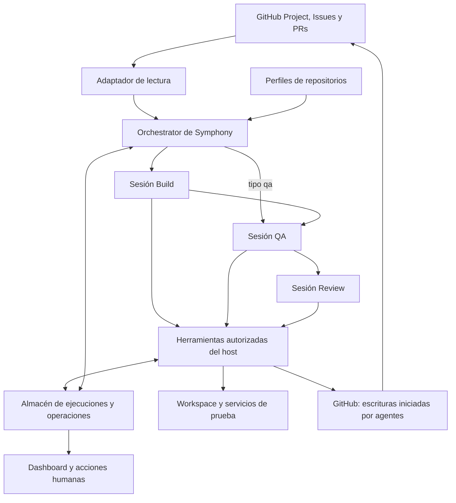

# Plan de implementación de Super Board sobre Symphony

**Proyecto:** [Compralaentrada/symphony](https://github.com/Compralaentrada/symphony)  
**Estado:** pipeline base de issue #9 terminado; delegación de escrituras a agentes aprobada en ADR-0002, implementación en issue #40
**Fecha:** 21 de octubre de 2026
**HEAD del fork revisado para este roadmap:** `4f2fbc8`
**Base de la investigación técnica:** `15a1af42fb6e9de044b7b72da3e0d54d1cc9a88d` de `Compralaentrada/symphony`

El fork convertirá Symphony en un servicio capaz de tomar tareas de un tablero compartido, ejecutarlas en el repositorio adecuado y conducirlas por Build, QA y Review hasta una entrega verificable. El objetivo operativo es que las tareas terminen o comuniquen un bloqueo concreto, conservando el trabajo cuando falle una dependencia o se reinicie el servicio.

La implementación parte del motor Elixir y Codex de Symphony. La capa de producto, la integración con el tablero y el pipeline se construirán en el fork. Super Board será la referencia funcional para las skills y sus criterios de calidad. El manager anterior queda fuera de la implementación y de sus dependencias.

Cada instalación puede elegir el tracker GitHub Issues existente o GitHub Projects v2. Projects v2 permite coordinar en un tablero común los repositorios registrados por esa instalación; el software no fija los seis repositorios actuales ni una organización. El piloto de esta fase usa Projects v2 con una issue del propio repo de Symphony, conservando el contrato del tracker GitHub Issues.

## 1 Objetivo y criterios de éxito

Una tarea admitida debe producir una PR con cambios y evidencias, una conclusión verificable de que no requiere cambios, o una pregunta o bloqueo que permita actuar a una persona. Terminar un turno del modelo o cerrar un proceso no equivale a terminar la tarea.

El sistema debe permitir:

- Gestionar todos los repositorios desde el mismo tablero, con vistas por repo y estado.
- Ejecutar Build, QA y Review con sesiones y responsabilidades diferenciadas.
- Aplicar las reglas del repositorio sin introducir un flujo manual diferente para cada tecnología.
- Reanudar tras un reinicio desde el último resultado confirmado, conservando ramas, artefactos y decisiones.
- Mostrar por qué una tarea avanza, espera o se bloquea, con un siguiente paso concreto.
- Limitar concurrencia, intentos, tiempo y consumo acumulado.
- Despachar tareas Ready con un máximo global configurable de cinco slots y dependencias explícitas.
- Mantener el estado del Project como autoridad, usando SQLite solo como diario interno de ejecución.
- Conservar el merge humano por defecto y permitir auto-merge únicamente con activación explícita y el gate completo.

La primera demostración útil será una tarea real que complete el recorrido hasta una PR revisable sin reparar manualmente el ejecutor entre fases. Después se comprobarán dos repositorios en el mismo tablero y la recuperación ante fallos.

## 2 Decisiones de partida

| Asunto | Dirección propuesta | Alcance |
| --- | --- | --- |
| Base | Fork existente de Symphony y referencia Elixir | Mantener transporte Codex, supervisión OTP, workspaces y observabilidad que sigan siendo válidos. |
| Tracker | Se conserva GitHub Issues y se añade Projects v2 | La instalación conserva el tracker existente; en modo Projects se configura un único Project ID para coordinar repositorios. |
| Estado del trabajo | El Project gobierna la intención y estado visible | SQLite registra ejecución, fases, checkpoints y operaciones; nunca sustituye una decisión visible del Project. |
| Escrituras de GitHub | Los agentes de fase gestionan issues, Projects y PRs | Symphony lee y coordina; las herramientas del host autorizan, verifican y registran las mutaciones iniciadas por los agentes. |
| Ejecución | Un servicio Symphony con perfiles de repositorio | Un scheduler global despacha tareas independientes a slots disponibles; no usa waves ni prioridad por fase. |
| Pipeline | `bug`/`feature`: Build → QA → Review; `qa`: QA → Review | La app define los estados y las skills del ciclo; cada fase autónoma usa una sesión separada. |
| Skills | Catálogo y enrutamiento propios de la app | Se usan skills fijadas solo cuando aplican; la instalación no configura el mapeo por fase. |
| Persistencia | SQLite en un host | Diario interno de ejecución, checkpoints, evidencias y operaciones idempotentes; el Project sigue siendo la autoridad del estado visible. |
| Configuración | Project, perfiles de repo, un modelo global, slots y política de merge | Cada perfil contiene repo, rama base y preparación del entorno; estados y skills son fijos de la app. |
| Slots | `max_active_tasks: 5` por defecto | Una tarea ocupa un slot durante Build, QA y Review; se despachan las Ready elegibles más antiguas. |
| Entrega | Human Review por defecto; auto-merge opt-in | `Done` exige verificar el merge; las esperas humanas liberan el slot. |
| Idioma | Español para títulos, explicaciones e informes | Mantener código, identificadores, comandos y nombres técnicos cuando corresponda. |

El primer piloto usa una issue de Symphony en un Project de prueba elegido en la configuración local. La arquitectura sigue siendo válida para cualquier instalación, organización y conjunto de repositorios. El merge automático permanece desactivado por defecto; la política puede activarlo explícitamente tras validar el gate.

El roadmap se limita al pipeline y a su operación: Projects, routing por repo, skills de Build/QA/Review, dependencias, slots, recuperación, seguridad y entrega. Intake, UI refine, visualización, calibración y otros productos de Super Board quedan fuera.

## 3 Base disponible y extensiones necesarias

Symphony ya incorpora sondeo y reconciliación de tareas, límites por proceso, reintentos, workspaces, sesiones de Codex mediante `app-server`, ejecución remota por SSH y un dashboard Phoenix. La referencia inspeccionada tiene adaptadores para varios trackers. Su adaptador GitHub trabaja con issues `open/closed` de un repo y no consume las columnas de Projects v2. [SY1], [SY2], [SY3]

El fork necesita añadir:

1. Un adaptador Projects que resuelva el item, la issue, el repositorio y el estado del tablero, conservando el adaptador GitHub Issues y su contrato actual.
2. Un registro de perfiles de repositorio y una configuración efectiva inmutable por intento.
3. Un pipeline explícito con contratos de resultado entre Build, QA y Review.
4. Persistencia de ejecuciones, esperas, evidencias y operaciones externas pendientes.
5. Herramientas del host para checks, publicación, estado del tablero y entrega.
6. Acciones operativas y diagnóstico comprensible de errores.

Los campos de configuración y los nombres de módulos que siguen son propuestas del fork. No deben tratarse como opciones que el Symphony actual ya acepte.

## 4 Arquitectura del servicio



El orquestador existente conserva el control del trabajo. La lógica del pipeline se incorpora a sus decisiones de despacho y finalización; no se introduce otro bucle que compita por ejecutar las mismas tareas.

El adaptador de Symphony es de solo lectura para descubrir y reconciliar issues, Projects y PRs. Las sesiones de Build, QA y Review solicitan las escrituras de GitHub que corresponden a su fase mediante herramientas mediadas por el host; las ejecuciones individuales del tracker GitHub Issues las solicitan desde el agente de esa tarea.

Cada ejecución captura el perfil del repo, las versiones de skills y herramientas, la rama base y sus SHA. Build, QA y Review reciben ese contexto explícito. Las lecturas globales de configuración que existen hoy deben revisarse en `AgentRunner`, `PromptBuilder`, `Workspace` y `Codex.AppServer`: cambiar una variable global antes de arrancar un agente no ofrece aislamiento entre repositorios concurrentes. [SY4], [SY5], [SY6], [SY7]

Se empezará con un host y un almacén de escritura. Los workers remotos y varias máquinas coordinadoras se habilitarán cuando el protocolo de propiedad de ejecución esté probado. El soporte SSH existente no implica que la afinidad por repo y plataforma esté resuelta.

## 5 Tablero común y modelo de tarea

### Estados visibles

En Projects v2, Symphony exige el campo y las opciones de estado definidos por la app: **Backlog, Ready, Building, QA, Review, Human Review, Blocked, Done y Dropped**. El onboarding valida que el Project los tenga; no se configura un mapping distinto por instalación. `Review` siempre significa revisión autónoma; la espera humana usa `Human Review`. El tracker GitHub Issues mantiene su contrato actual de issues abiertas y cerradas.

| Columna | Significado | Condición para actuar |
| --- | --- | --- |
| Backlog | Trabajo recogido que aún no está admitido | No ejecuta agentes. |
| Ready | Petición de ejecución o reanudación | Exige repo registrado, criterios y perfil válidos. |
| Building | Implementación en curso | Debe existir un intento propietario y contexto de código. |
| QA | Verificación o análisis de huecos de pruebas | Usa el SHA de la entrega vigente. |
| Review | Revisión autónoma | Usa una sesión nueva y el SHA validado por QA. |
| Human Review | Espera de decisión humana sobre una PR lista para revisión | QA y Review pasaron; la persona puede aprobar/mergear o pedir cambios. |
| Blocked | Falta información, acceso o una decisión | Debe mostrar motivo y acción para desbloquear. |
| Done | PR fusionada y merge confirmado | Cualquier otra resolución queda fuera de `Done`. |
| Dropped | Trabajo terminado sin merge | Requiere un motivo explícito en la issue; si falta, espera intervención en `Blocked`. Una conclusión de “sin cambios” requiere confirmación humana. |

Cada fase usa una sesión nueva. La espera en `Human Review` libera el slot y persiste tras reiniciar. El agente de cada fase publica su resultado y el motivo de bloqueo o descarte en la issue vinculada.

### Identidad y campos

La identidad estable contendrá `project_id`, `project_item_id`, `issue_node_id` y `repository_id`. La referencia humana será `owner/repo#number`. Cambiar el título, renombrar el repo o repetir `#42` en otro repositorio no debe crear una ejecución incorrecta. La branch y el workspace incluirán un identificador único del intento.

El item debe vincular una issue, un repo registrado y un tipo de tarea. Las dependencias se leen de relaciones explícitas entre issues. `bug` y `feature` recorren Build → QA → Review; `qa` entra directamente en QA y luego pasa por Review, sin fabricar una fase de implementación. La antigüedad de Ready decide el despacho; la prioridad del Project no altera el orden. [SB1]

Las ideas sin issue pueden permanecer en Backlog. Para pasar a ejecución deben convertirse en una issue con repo inequívoco. Un item PR se vincula como resultado; no se interpreta automáticamente como una nueva tarea de implementación.

### Autoridad y sincronización

El Project es la autoridad del estado visible y la intención humana. SQLite es un diario interno de intentos, fases, checkpoints, evidencias y efectos externos; no puede contradecir ni reemplazar el estado del Project. Al reiniciar, Symphony reconcilia el Project, GitHub y SQLite antes de reanudar. Si no puede resolver una discrepancia sin adivinar, detiene la tarea y muestra el motivo.

Mover a `Ready` inicia o reanuda según el estado anterior. Si una persona pide cambios desde `Human Review`, el agente de Build devuelve la misma PR a draft y conserva su rama; tras rehacer Build y repetir QA y Review, el agente de Review la marca lista para revisión antes de volver a `Human Review`. Desde `Blocked`, se conserva la rama y PR si existen y se reanuda desde el último checkpoint confirmado. Una issue cerrada en `Done` no se reactiva al mover el item del Project a `Ready`; el trabajo posterior requiere una issue nueva. Mover una tarea activa a `Blocked` o `Backlog` solicita parar: Symphony cancela el proceso, conserva el trabajo y confirma la parada. Un cambio manual a `Done` no acredita un merge.

El agente de fase publica la rama e inicia las mutaciones GitHub necesarias para completar su lane mediante herramientas autorizadas. En una ejecución individual desde GitHub Issues, su agente gestiona las mutaciones permitidas de esa issue y su PR. El orquestador verifica repo, rama, SHA, estado remoto y generación; coordina el siguiente agente y reconcilia efectos confirmados, pero no inicia escrituras en issues, Projects o PRs. Una respuesta incierta requiere consultar GitHub antes de repetir la operación o volver a despachar la fase.

Una indisponibilidad de GitHub mantiene el estado conocido y limita los efectos nuevos. Las lecturas paginadas incompletas, permisos insuficientes o respuestas GraphQL con errores no equivalen a un tablero vacío.

El adaptador valida el campo y las opciones canónicas durante el onboarding. No crea columnas, renombra estados ni migra tareas al arrancar. Projects permite consultar items y mutar campos mediante GraphQL. [GH1]

## 6 Registro de repositorios y configuración

La configuración de instalación contiene el Project ID, la lista de perfiles de repositorio, un modelo común para todas las fases, `max_active_tasks` y la política de merge. Cada perfil de repo declara su identidad remota, rama base y preparación del entorno. Los estados, las fases, el catálogo de skills y su routing son propios de la app, no opciones por instalación.

Estructura propuesta, pendiente de implementar:

```text
WORKFLOW.md                         Project ID, modelo, slots, merge y perfiles de repos
skills/*/SKILL.md                   skills incluidas y mantenidas por la app
skills/catalog.lock.json            procedencia y revisiones fijadas
docs/superboard-symphony-plan.md     especificación y roadmap del pipeline
```

El archivo de bloqueo registra SHA y huella de contenido; la app resuelve skills aplicables y verifica su disponibilidad, sin permitir que una instalación las remapee por fase. Las credenciales y los datos de ejecución se guardan fuera del repositorio.

Ejemplo conceptual de configuración; este esquema no existe todavía en el fork:

```yaml
project_id: github-project-node-id
model: configured-model
max_active_tasks: 5
merge_policy: human # auto solo por activación explícita
repositories:
  - repository: owner/example-repo
    base_branch: main
    prepare: ["mise", "install"]
```

El modelo se aplica a Build, QA y Review y no cambia silenciosamente ante un error. No se ejecutan comandos interpolados desde el título de una tarea; la preparación del repo usa argumentos estructurados, con directorio de trabajo, timeout y entorno permitidos. Los checks se obtienen de las instrucciones y herramientas del repo junto con los controles fijos de la app. La configuración efectiva se valida y se guarda por intento antes de ejecutar código.

Precedencia: invariantes de la app → configuración de instalación → instrucciones del repo → instrucciones específicas de la tarea. Las reglas del repositorio pueden exigir más comprobaciones; una contradicción material bloquea la admisión con un diagnóstico. El contenido de una issue no modifica permisos del ejecutor.

Al recargar configuración, los intentos activos conservan su snapshot de repo, modelo y límites. Una petición explícita de parada o una revocación de acceso puede cancelarlos. Esto separa recarga rutinaria de revocación operativa.

## 7 Contrato del pipeline

### Admisión y preparación

Antes de gastar un turno, el host comprueba Project, issue, repo y rama base, preparación del entorno, modelo configurado, disponibilidad de las skills fijas y estado del workspace. El scheduler considera elegible una tarea Ready solo cuando sus dependencias explícitas están resueltas. Una tarea con una dependencia pendiente permanece en `Ready` sin ocupar slot; si la relación no puede interpretarse, requiere intervención y pasa a `Blocked` con un motivo claro.

El scheduler llena los slots libres con las tareas Ready elegibles más antiguas. Una tarea ocupa un slot durante sus fases automáticas Build, QA y Review; libera el slot al terminar, quedar `Blocked` o esperar en `Human Review`. No hay waves, prioridad por fase ni capacidad independiente por lane. `max_active_tasks` limita el total de tareas activas.

Los fallos de entorno se comunican con comando o recurso afectado y solución propuesta. No se transforma un fallo del ejecutor en una devolución al Builder para que reescriba código del producto.

La tarea conserva un formato común: problema, contexto, cambio esperado, criterios de aceptación, riesgo y dependencias. Los criterios deben ser observables. La operación equivalente a `super-board lint` revisa esa preparación; no ejecuta el linter del lenguaje. Las tareas ya clasificadas como documentación, refactor o tests conservan su clasificación sin forzar `feature` o `bug`. [SB6], [SB7]

### Build

El Builder recibe la tarea y sus criterios, instrucciones del repo, skills resueltas y contexto del intento. Antes de trabajar, reclama la issue mediante la herramienta autorizada. Implementa en su workspace, añade las pruebas pertinentes, publica su rama y crea o actualiza la PR en borrador. Entrega el SHA y la evidencia remota del claim, la PR y el handoff a QA.

Su salida incluye resumen, criterios cubiertos, SHA de código, archivos cambiados, pruebas propuestas o ejecutadas, riesgos y bloqueos. El Builder publica el informe en issue y PR y mueve el Project a QA cuando la entrega queda verificada. Symphony valida que la rama, SHA y efectos remotos correspondan al repo e intento correctos; un mensaje del modelo que diga «PR creada» no acredita ese efecto.

Los informes de Build incluyen resumen del trabajo, criterios cubiertos, cambios, pruebas, riesgos, SHA y siguiente paso. El Builder conserva el contenido humano y solo actualiza sus propios bloques de informe.

Si no hacen falta cambios, el agente deja una explicación con evidencias y espera confirmación humana. Tras confirmarla, el agente registra el motivo y solicita `Dropped`; no se fabrica una PR vacía.

### QA

QA es el lane de Tester para una issue concreta. No es el crawler autónomo `/super-qa`: recibe una tarea y su entrega, verifica esa entrega y deja evidencia para que otra sesión pueda desafiarla. La tarjeta `qa` entra por este mismo lane sin ejecutar Build; una tarjeta `bug` o `feature` llega desde Build. [SB1], [SB8]

**Entradas:** criterios de aceptación observables; issue y PR vinculadas; repo, branch y `head_sha` aceptado; informe y cambios de Build si existen; hallazgos anteriores aún abiertos; instrucciones y comandos de verificación del repo; checks requeridos por el perfil. QA no puede declarar que un SHA distinto del aceptado es el que probó.

**Trabajo:**

1. Ejecutar la verificación local aplicable y cubrir cada criterio con una observación o test identificable. Elegir la capa adecuada (unit, component o E2E) al comportamiento que se quiere probar; un mock que no comprueba comportamiento observable no cuenta como cobertura del criterio.
2. Revisar los huecos de tests por criterio: aserción, ruta cubierta, límites y errores pertinentes, determinismo y si el test fallaría ante el defecto que pretende detectar. No convertir mejoras de cobertura de bajo riesgo en bloqueos.
3. Para un hueco de alto riesgo, añadir primero el test que reproduce el problema y completar la cobertura con TDD. QA puede modificar y publicar tests y artefactos de evidencia en la branch de la issue; no implementa cambios de producto. Si el test demuestra un defecto de producto, o cubrir el criterio exige cambiar producto, registra el defecto y lo devuelve a Build.
4. Cuando un criterio sea visual, probar la UI y guardar capturas en los viewports pertinentes. Si la issue no tiene superficie visual, omitir capturas con esa razón.
5. Separar defectos de producto de fallos del ejecutor. Un error de entorno, acceso o herramienta registra comando/recurso afectado y solución; bloquea la tarea sin mandar al Builder a cambiar código.

**Entrega:** publicar un informe vinculado al SHA final de QA. Para cada criterio, incluir estado, test o procedimiento, evidencia y cualquier omisión justificada. Registrar comandos exactos, resultado, duración cuando esté disponible, pruebas/capturas añadidas, cambios de QA, checks del host, hallazgos con IDs estables y siguiente paso. Los checks obligatorios ejecutados por Symphony se registran como evidencia del host, separados de lo que afirma el agente. Si QA añade tests, esos cambios forman parte de la branch y el `head_sha` entregado a Review debe incluirlos.

**Salida:** pasar a Review solo si todos los criterios están verificados, el informe corresponde al SHA actual y los checks obligatorios están aprobados. Un defecto de producto o un hueco que requiera cambios de producto vuelve a Building con reproducción y criterio incumplido; un fallo de entorno/acceso va a Blocked. Los tests de QA que fallen por un error del propio test se corrigen dentro del lane antes de entregar. Un check requerido omitido, inestable, fallido o no disponible nunca se presenta como aprobado. [SB8]

### Review

Review es una verificación independiente del informe de QA y el gate autónomo previo a la espera humana. No vuelve a hacer el trabajo de Tester: decide si el diff, los criterios y la evidencia sostienen la entrega y si la PR puede avanzar. Usa una sesión nueva. [SB9]

**Entradas:** issue y PR; criterios; branch, `head_sha` y base; diff bruto; informe QA completo, sus tests/comandos/evidencias y resultado de checks del host; informe de Build si existe; hallazgos anteriores con su historial. El agente formula hipótesis desde criterios y diff antes de usar las conclusiones de Build/QA para reducir el arrastre de contexto.

**Trabajo:**

1. Inspeccionar los criterios y el diff de forma independiente, luego contrastar cada criterio con el informe y la evidencia QA. En una entrega `bug`/`feature`, revisar código de producto y tests modificados. En una tarjeta `qa`, revisar el informe y el diff de tests/evidencia; no inventar una revisión de código de producto que no forma parte de esa entrega.
2. Volver a ejecutar exactamente el comando de tests local que QA dejó en su informe, en el mismo checkout y SHA. Registrar comando y resultado. Si SHA cambió, el comando no está disponible o no puede reproducirse, no aprobar con la evidencia vieja: devolver a QA o bloquear por causa operativa.
3. Revisar correcciones de hallazgos previos. Mantener el ID estable y declarar cada uno como resuelto con prueba, aún abierto o ya no aplicable con motivo. Un hallazgo abierto no desaparece por no repetirse en el informe nuevo.
4. No modificar el producto ni los tests durante Review. Registrar hallazgos accionables con tipo, severidad, ubicación, reproducción, criterio afectado e ID estable. La severidad describe impacto o criterio incumplido; una preferencia de estilo aislada no bloquea.
5. Aplicar el pase adversarial adicional solo al umbral de riesgo configurado. Repetir el mismo modelo no se presenta como independencia; el gate determinista del host sigue comprobando SHA, base, checks, permisos y política de merge.

**Entrega y salida:** publicar el informe, resoluciones y SHA revisado. Hallazgos de producto vuelven a Building; defectos en tests, comando o evidencia vuelven a QA; fallos de entorno/acceso van a Blocked. Si no quedan hallazgos bloqueantes, el SHA está vigente y todos los gates pasan, Review deja la PR lista para revisión humana y mueve el Project a `Human Review`. Con `merge_policy: auto`, Review solo solicita el merge al gate del host; no fusiona por decisión libre del modelo y solo marca `Done` cuando el merge está confirmado en la base. [SB9]

El solapamiento con QA es deliberado y acotado: QA produce tests, resultados y evidencia; Review los desafía desde una sesión nueva y repite el comando de tests reportado. QA responde «¿está probado cada criterio y qué evidencia lo demuestra?»; Review responde «¿puedo confiar en esa prueba y en este diff para entregar el SHA?». Ese doble control no elimina la obligación de asignar cada hallazgo a la fase que puede corregirlo. [SB8], [SB9]

### Brecha de implementación actual

El diseño anterior es el objetivo; el pipeline implementado aún no lo cumple. `AgentRunner` prohíbe cambios de archivos tanto en QA como en Review y el contrato QA actual no exige matriz de criterios, comando repetible ni evidencia de pruebas creada por el agente. El orquestador entrega a Review el SHA y los hallazgos previos, pero no el informe QA completo. Finalmente, `Pipeline` envía cualquier resultado con cambios solicitados de QA o Review a Building. Las tareas nuevas del roadmap deben cerrar estas tres brechas: QA como productor de pruebas/evidencia, Review como validador independiente de esa entrega y routing por responsable del hallazgo.

La diferencia con el comando autónomo `/super-qa` es intencional. Este pipeline no añade crawling BFS, diez iteraciones exploratorias ni commits directos en una branch sin issue; cubre solo el lane de Tester vinculado a la tarea. [SB8]

### Entrega y cierre

Con QA y Review aceptados, el sistema guarda una entrega revisable vinculada a `head_sha`, `base_sha`, configuración y versiones de skills. El agente de Review marca la PR lista para revisión y mueve la tarea a `Human Review`. Así la persona puede revisar, aprobar y fusionar. Cada agente publica su propio informe en la issue; Symphony conserva los resultados localmente y verifica las referencias.

La PR se crea como draft tras Build. GitHub permite cambiarla a lista para revisión o devolverla a draft; mientras siga como draft no se puede fusionar. [GH3]

Una persona puede fusionar la PR o pedir cambios. Si pide cambios, mueve la tarea a `Ready`; el agente de Build conserva la rama y PR y la devuelve a draft. Si pasan de nuevo, el agente de Review la marca lista para revisión. El merge humano es el predeterminado. Con auto-merge opt-in, Review solicita la fusión al gate determinista del host y solo marca `Done` tras comprobar el merge confirmado en la rama destino.

`Done` exige confirmar el merge y su presencia en la rama destino. Cerrar una issue sin merge termina el trabajo como `Dropped` con motivo. Si el agente no encuentra cambios necesarios, `Dropped` requiere confirmación humana. Una issue que ya está cerrada y fusionada no se reabre moviendo el item del Project a `Ready`; para trabajo posterior se crea una issue nueva.

### Tabla de transiciones

| Desde | Evento validado | Siguiente estado | Responsable |
| --- | --- | --- | --- |
| Ready | Admisión; lease local y claim visibles confirmados | Building o QA para tipo `qa` | Orquestador y agente |
| Building | Entrega y contexto de código válidos | QA | Agente Build; Symphony valida |
| QA | Checks y criterios aceptados | Review autónoma | Agente QA; Symphony coordina |
| QA | Defecto de producto o cobertura que requiere cambio de producto | Building con reproducción, criterio e IDs abiertos | Agente QA |
| QA | Criterios verificados en el SHA final; checks requeridos aprobados | Review con informe, tests y evidencia | Agente QA |
| Review | Hallazgo de producto | Building; la nueva entrega vuelve a QA | Agente Review |
| Review | Defecto en tests, comando o evidencia QA | QA; conserva los hallazgos y el diff actual | Agente Review |
| QA o Review | Fallo de entorno, acceso o herramienta | Blocked con recurso/comando y acción | Agente de fase |
| Cualquier fase activa | Falta información o acceso | Blocked con motivo persistido | Agente de fase |
| Human Review | La persona pide cambios | Ready; misma rama y PR, PR a draft, después Building | Persona y agente Build |
| Review | QA y Review aceptadas; PR lista para revisión | Human Review | Agente Review |
| Human Review | Merge confirmado en la rama destino | Done | Agente Review mediante gate |
| Fase activa | El proceso ya no puede continuar sin intervención | Blocked; conserva el checkpoint | Agente de fase y Symphony |
| Blocked | La persona resuelve el bloqueo y mueve a Ready | Reanudar desde el último checkpoint, conservando rama/PR | Persona y orquestador |
| Issue cerrada sin merge | Motivo de cierre registrado | Dropped; si falta motivo, Blocked hasta recibirlo | Persona y agente de fase |
| Build | No hacen falta cambios y una persona confirma la resolución | Dropped con motivo | Persona y agente Build |
| Done | El item del Project se mueve a Ready, pero la issue está cerrada | Sin efecto; hace falta una issue nueva | Orquestador |

Los fallos transitorios conservan los reintentos existentes. `Blocked` se usa cuando hace falta intervención. Las fases se implementarán en código con transiciones admitidas; no dependerán de que una skill recuerde cambiar una columna ni del exit code del proceso Codex.

### Resultado estructurado de fase

Cada rol entrega un resultado que el host valida contra un esquema versionado. Ejemplo conceptual de una salida QA; los valores de identidad y evidencia deben corresponder a registros existentes:

```json
{
  "schema": "symphony-phase-result/v1",
  "run_id": "run-unique-id",
  "generation": 1,
  "phase": "qa",
  "repository": "Compralaentrada/vue.teatros-clubs",
  "head_sha": "full-commit-sha",
  "base_sha": "full-base-sha",
  "config_digest": "effective-config-digest",
  "outcome": "passed",
  "summary": "Criterios verificados en la entrega indicada",
  "evidence_ids": ["check-record-id"],
  "findings": [],
  "questions": []
}
```

Resultados admitidos: `passed`, `changes_requested`, `needs_input` y `blocked`. Una respuesta malformada es un error de contrato, con corrección acotada; no una aprobación. Los checks e IDs de evidencia deben provenir del host, y un resultado aprobado debe cubrir los requisitos del rol. Las preguntas, los hallazgos y el resumen tienen límites de tamaño. Un resultado por sí solo no cambia el Project ni cierra una issue: esas operaciones deben ejecutarse mediante herramientas autorizadas y quedar verificadas en GitHub.

El contrato de QA incluye por criterio el estado, las pruebas/procedimientos, los comandos exactos y referencias de evidencia; los checks ejecutados por el host quedan identificados como tales. El contrato de Review incluye el SHA/base revisados, el comando QA repetido y su resultado, más resoluciones explícitas de cada hallazgo previo. Ambos informes deben ser legibles por la siguiente fase sin depender del texto de una conversación anterior.

## 8 Skills y herramientas de Super Board

El fork conserva la cobertura de las skills del pipeline de Super Board mediante skills mantenidas y versionadas por la app. El resolver selecciona las que aplican a cada tarea y fase; una instalación no cambia el routing. [SB2]

| Skill | Función en el fork | Adaptación |
| --- | --- | --- |
| `super-board` | Política general, admisión y operación del pipeline | Extraer decisiones verificables al código y mantener la guía de trabajo. |
| `super-build` | Implementación por criterios y entrega | Crear la draft PR, informar y mover el Project usando las herramientas autorizadas del host. |
| `super-qa` | Checks, huecos de pruebas y evidencias | Registrar evidencias e informes y avanzar o devolver la tarea mediante las herramientas autorizadas. |
| `super-review` | Revisión, hallazgos persistentes y validación de correcciones | Gestionar hallazgos, preparar la PR para revisión y solicitar merge solo mediante el gate. |

El catálogo fijo de la app incluye las skills integradas de Matt Pocock, Impeccable y Humanizer. El resolver aplica cada una solo cuando la tarea lo requiere, además de las skills de Build, QA y Review. Registra origen, revisión, licencia y huella; si falta una skill requerida, la tarea no se reclama y se muestra el fallo de readiness.

Las instrucciones del repo se descubren en cada checkout. Una actualización de skills se prueba con tareas representativas y se aplica a nuevos intentos. QA y Review pueden reproducir una ejecución con las mismas versiones de la entrega original.

La resolución distingue skills obligatorias, condicionales, opcionales e interactivas. Un worker desatendido no carga una skill que exige diálogo interactivo para completarse. Readiness debe comprobar la skill efectiva y su contrato; el resolver existente comprueba disponibilidad, pero el pin de revisiones es una extensión del fork. [SB10]

Los comandos de Super Board son referencia de experiencia de uso, no una obligación de conservar su implementación shell. El fork cubre onboarding, ejecución, estado, parada y limpieza necesarios para operar el pipeline. Clasificación automática de intake, calibración y comandos de visualización quedan fuera.

| Interfaz observada en Super Board | Equivalente funcional en el fork |
| --- | --- |
| `onboard` | Registrar y validar repo, herramientas y acceso al Project. |
| `lint` | Revisar claridad de tareas y criterios de admisión. |
| `status` | Consultar fase, progreso, PR y bloqueos. |
| `run` y reanudación mediante `run` | Activar admisión o solicitar continuación controlada. |
| `stop` | Detener trabajo conservando contexto y artefactos. |
| Modelo explícito | Un modelo común para Build, QA y Review, configurado por instalación sin fallback silencioso. |

La app no añade comandos ni productos de `super-collect`, `ui-refine-loop`, `visual` o `git-sync`; las comprobaciones de UI que formen parte de una tarea siguen siendo parte de QA y usan las herramientas disponibles en el repo. [SB6], [SB11], [SB12], [SB13]

### Formato de los entregables

Los informes de Build, QA y Review usan bloques identificables por rol, sin sobrescribir contenido humano. El título y cuerpo de la PR explican problema, cambio, criterios, evidencias y limitaciones concretas. Los comentarios de estado comunican rol, resultado y siguiente acción sin convertir el hilo en un volcado de logs.

El estándar de escritura de Super Board aporta plantillas, pero el perfil del repo conserva las convenciones necesarias para su automatización de releases. Un formato de commit con prefijos adicionales debe comprobarse frente a herramientas como release-please antes de adoptarlo. [SB7]

## 9 Herramientas que ejecuta el host

Las siguientes operaciones son contratos propuestos, no APIs existentes de Symphony:

| Operación | Qué controla el host | Evidencia de salida |
| --- | --- | --- |
| Preparar workspace | Repo autorizado, branch, ruta canónica y entorno | Identidad del workspace y SHA base. |
| Ejecutar check | Comando permitido, timeout, entorno y captura de salida | Inicio, fin, exit code, resultado y archivos de evidencia. |
| Validar entrega del agente | Repo, branch, SHA, intento y remoto correctos | Commit y SHA remoto consultados. |
| Escribir en issue o Project | Agente de ejecución solicita claim, informe, transición o cierre; el host limita repo, identidad, rol y estado | Escritura consultada en GitHub y evidencia devuelta al agente. |
| Gestionar PR | Build o Review solicita crear/actualizar, cambiar draft/ready o resolver feedback | PR y operación consultadas en GitHub; sin alterar contenido humano ajeno. |
| Solicitar merge | Solo Review lo solicita con el SHA revisado | Gate del host valida política, SHA, base, checks y permisos; nunca se acepta una aprobación del modelo. |
| Publicar informe de fase | Agente entrega resultado, identidad e idempotency marker | Comentario consultado en issue/PR sin duplicados ni sobrescribir comentarios humanos. |
| Pedir aclaración | Pregunta concreta y relación con la tarea | Espera persistida y punto de reanudación. |
| Registrar revisión | SHA revisado y hallazgos estructurados | Informe y revisión verificables. |

El agente inicia las escrituras de issue, Project y PR. Symphony valida su identidad y evidencia, y registra/reconcilia las operaciones sin duplicar el efecto. El merge es humano por defecto. Auto-merge requiere activación explícita y el gate de la app; el agente nunca puede saltárselo mediante credenciales o shell. El aislamiento debe hacer efectivas las restricciones prometidas.

Las herramientas base incluyen Git, Codex `app-server`, acceso API GitHub y runtimes del repo. GitHub CLI puede servir para diagnóstico o como transporte inicial encapsulado; las mutaciones del producto no se reparten entre scripts independientes sin contratos comunes.

Browser y Playwright pueden usarse en QA si el repo y su entorno los incluyen. Crear conectores a Nightwatch, Sentry, PostHog, Asana u otros MCP queda fuera del pipeline de este roadmap; el servicio no asume que un plugin externo existe en cada instalación.

Las comprobaciones de UI pertenecen a QA cuando la tarea lo exige y existe un entorno reproducible. Una página vacía, una pantalla de login o un backend caído no cuentan como verificación de una pantalla del producto. Los productos autónomos de exploración visual quedan fuera. [SB8]

## 10 Persistencia y recuperación

### Datos mínimos

| Registro | Contenido y propósito |
| --- | --- |
| Tarea | Identidad global, repo, último estado observado del Project y generación admitida. |
| Ejecución | Fase, contexto de código, propietario, límites, configuración capturada y punto de recuperación. No es autoridad del estado visible. |
| Intento de fase | Sesión, inicio y fin, resultado, error y consumo. |
| Evidencia | Entrega y SHA asociados, check, revisión, informe de fase y ubicación de artefactos. |
| Operación externa | Intención solicitada por agente, clave estable, estado de confirmación y referencia remota para issue, Project o PR. |

El primer almacén será SQLite en un host y ofrecerá transacciones y restricciones de unicidad. Sus ficheros y artefactos requieren volumen persistente, copia y restauración. No se incluye un bus de eventos ni una cola distribuida como requisito inicial.

### Propiedad de ejecución

Debe existir como máximo un intento activo por tarea y generación. `max_active_tasks` establece el límite global de tareas activas y vale cinco por defecto. Cada tarea ocupa un slot durante Build, QA y Review; las esperas en Human Review, Blocked, una parada a Backlog y los estados terminales liberan capacidad. No hay límites distintos por fase ni prioridad de lanes. Un token de propiedad impide que un proceso antiguo publique resultados después de que otro haya recuperado su trabajo.

Al reiniciar, el servicio lee primero la intención vigente del Project y consulta las PR y ramas remotas; después usa SQLite para reconciliar procesos vivos, workspaces, branches, checkpoints y efectos remotos. No restaura un estado visible antiguo desde SQLite. Si una operación externa quedó incierta, consulta GitHub antes de repetirla; si la intención humana y el checkpoint no se pueden combinar con seguridad, requiere intervención.

Una sesión de Codex puede continuar si el protocolo y sus datos lo permiten. Si no, se abre una nueva sesión desde el último checkpoint confirmado, con la conversación resumida y las evidencias. La garantía del fork será recuperar el trabajo, no prometer restauración exacta de toda conversación sin haberla implementado. El código actual guarda los bloqueos en memoria y necesita persistencia adicional. [SY2], [SY8]

### Operaciones externas e idempotencia

Antes de que una herramienta ejecute una mutación solicitada por un agente, el host registra una intención durable. Cada operación usa una clave que incluya tarea, generación, fase, intento y tipo de efecto. Si una respuesta se pierde, el agente o el reconciliador consulta GitHub antes de decidir si la operación se realizó o puede repetirse.

No se promete atomicidad entre GitHub y la base local. Una PR se reconoce por repo, branch y marcador del intento; una publicación se reconoce por su SHA remoto; un informe se reconoce por su marcador de tarea, fase e intento. Los informes son publicados por los agentes y conservan los informes anteriores y los comentarios humanos.

Las operaciones confirmadas no se repiten al reanudar. Un worker que perdió su token de propiedad no puede aprobar una transición ni publicar mediante herramientas del host.

### Política de errores

| Error | Tratamiento |
| --- | --- |
| Lectura temporal de GitHub o límite de API | Backoff con demora del proveedor, sin interpretar vacío ni perder estado. |
| Mutación con respuesta incierta | Estado de reconciliación; consultar antes de repetir. |
| Herramienta o autenticación ausente | Bloqueo operativo visible; no bucle de implementación. |
| Fallo de test relacionado | Hallazgo QA y vuelta a Build con evidencia. |
| Check no disponible | Espera o decisión humana según perfil; nunca PASS ficticio. |
| Proceso interrumpido | Conservar workspace y reconciliar sesión y efectos. |
| Falta de avance o agotamiento de límites | Parar con resumen, último checkpoint y opciones de continuación. |
| Cambio de HEAD durante QA o Review | Invalidar evidencia afectada y revisar la nueva entrega. |

Los límites acumulados incluirán intentos de fase, rebotes, tiempo total y tokens. Si no hay precio verificado para un modelo, se controla consumo por tokens; no se publica un coste monetario inventado. Los límites de turnos de una sesión de Codex no bastan como presupuesto de toda la tarea. [SY8], [SY9]

El esquema debe exigir límites finitos o aplicar defaults explícitos y finitos. El contador de intentos no vuelve a cero al reiniciar el servicio ni al cambiar de configuración. La política distingue reintentos de infraestructura y ciclos de corrección del producto para que un fallo externo no consuma indefinidamente turnos de Build.

## 11 Workspaces y entornos por repositorio

Para la primera versión se propone un clon aislado por ejecución. Facilita separar permisos y directorios Git; el caché de descarga puede compartirse como recurso de lectura controlado. Los worktrees de un clon común pueden evaluarse posteriormente, comprobando acceso al Git common dir y hooks.

La ruta combina repo, identidad de tarea y generación. Ningún agente trabaja en el checkout habitual. El bootstrap resuelve versiones y dependencias antes de comenzar, con manifiestos fijados y un resultado de readiness. No se reutilizan dependencias de otra rama si sus manifiestos no coinciden.

Los servicios de prueba pertenecen al entorno de ejecución. Bases de datos, puertos, procesos web y artefactos no pueden colisionar entre tareas concurrentes. Las pruebas nunca reciben una base de producción por defecto. El nombre `local` de un archivo o una variable no demuestra aislamiento: el bootstrap valida el destino efectivo.

La limpieza ocurre después de confirmar los efectos y guardar evidencias. Las tareas bloqueadas o interrumpidas conservan trabajo; la retención posterior tiene plazo y comando de recuperación. Un fallo de limpieza se muestra como fallo operativo distinto del resultado del producto.

Los hooks existentes `after_run` y `before_remove` ignoran sus errores tras registrarlos: los checks que deciden aceptación deben ejecutarse como pasos obligatorios del pipeline. [SY6]

## 12 Perfiles de ejemplo para el despliegue de Compralaentrada

La tabla siguiente ilustra perfiles que Compralaentrada podría registrar para su instalación. No es una lista permitida en el producto ni parte del código; una instalación externa configura sus propios repositorios. La primera entrega piloto solo ejecuta una issue de Symphony.

| Repo | Perfil y comprobaciones a concretar | Particularidades |
| --- | --- | --- |
| `vue.teatros-clubs` | Vue 2.7, Node 22 declarado, unit tests y checks por impacto | Resolver lint y deuda previa conforme al perfil; Playwright necesita UI y backend de ensayo cuando aplique. |
| `nuxt.compralaentrada-admin` | Nuxt 2, runtime compatible con lockfile, pruebas Node y build | Hay pruebas `node:test` aunque no exista un script `test`; definir cobertura y validación de UI por tarea. |
| `laravel.api-backend` | Laravel 11 y PHP compatible con el proyecto | PHPUnit Unit y Feature usa SQLite en memoria; suite MySQL y Redis es optativa y separada. |
| `laravel.comunicados-backend` | Laravel 12 y entorno de PHP y PostgreSQL de prueba | Respetar el bootstrap, los seeders y el uso de PostgreSQL que exige el proyecto. |
| `laravel.asana-bridge` | Laravel 12, Livewire y pruebas PHP y Node del worker | Se gestiona como repo de producto; no se usa como motor de este fork. |
| `flutter_kiosko_compralaentrada` | Flutter y Dart fijados, análisis, unit y widget con fakes | macOS y Windows, impresora y terminal de pago requieren verificaciones de plataforma y smoke específicos. |

Los comandos concretos se extraerán de los archivos vigentes de cada repo al implementar su perfil. La prueba del propio fork usará los requisitos de `elixir/AGENTS.md`; los checks de los productos usarán sus reglas y herramientas.

Una tarea que afecte a API, administración y kiosco se divide en subtareas por repo vinculadas a una épica común. Las dependencias expresan orden y contratos compatibles; no se promete una transacción de merge entre repositorios. La entrega incluye la compatibilidad del cambio durante el despliegue progresivo.

## 13 Aislamiento y controles de entrega

Los permisos se separan entre coordinación y ejecución: Symphony mantiene acceso de lectura al tracker; las sesiones reciben herramientas GitHub mediadas por el host, limitadas al repo, lane y operaciones autorizadas para ese intento. El host aplica permisos, registra los efectos y evita que shell o credenciales del proceso salten el gate de merge. El entorno de los procesos hijo se construye expresamente; eliminar variables conocidas de tracker no garantiza por sí solo que otras credenciales del host sean inaccesibles. [SY7]

Los límites efectivos deben cubrir rutas canónicas y symlinks, `.git`, ramas autorizadas, acceso a servicios de prueba y red requerida. Las ramas protegidas no reciben pushes directos. Los hooks shell se ejecutan con permisos del host: su contenido debe proceder de configuración revisada y no de la tarea.

Los hooks de Super Board son filtros de su host original y no se trasladan como garantía de autorización. Los invariantes del fork se comprueban en código y con el aislamiento real del proceso.

La política de merge es global, `human` por defecto. `auto` solo se activa explícitamente y exige el mismo gate de seguridad. La autorización identifica repo, PR, HEAD revisado, base validada y política efectiva; cualquier cambio de código invalida la aprobación.

Las protecciones y checks de GitHub completan el control de integración. Un mutex local y un pin del HEAD no impiden por sí solos que otro actor mueva la base remota; la estrategia de merge debe incluir validación actualizada o cola de merge. [SB3], [SB4]

La aprobación también identifica el alcance de operaciones autorizado. Una etiqueta del tablero no equivale a una aprobación de merge. El fallo del mecanismo que valida permisos o evidencia impide ejecutar la mutación protegida. Los filtros de los hooks del catálogo original que continúan ante errores propios no proporcionan ese contrato. [SB4], [SB14]

## 14 Operación y observabilidad

El tablero es la superficie principal de tareas. El dashboard Symphony explica la ejecución: repo, fase, subestado, intento, duración, consumo, PR, último resultado y siguiente acción. Las esperas humanas y la reconciliación deben ser distinguibles de un agente activo.

Acciones propuestas para el operador: pausar admisión global o por repo; parar una ejecución; responder una aclaración; reanudar desde checkpoint; reintentar una fase después de reparar el entorno; consultar evidencias; aprobar o rechazar una entrega según política; y solicitar limpieza de un workspace ya retenido.

Cada acción valida identidad, estado esperado y token de revisión, y deja registro. El router actual solo ofrece observabilidad y refresh; estas operaciones necesitan endpoints nuevos y control de acceso. No se expone una consola de mutaciones en una red compartida sin autenticación. [SY10]

Los logs incluyen task, repo, run, fase, intento, sesión y operación. Se conservan los errores originales de herramientas y un resumen legible. Los tokens y datos sensibles se eliminan de informes y logs. Para gestionar fallos, el mensaje debe indicar qué ocurrió, dónde quedó el trabajo y qué permite continuar.

El onboarding valida herramientas y acceso antes de activar el repo. Su modo de diagnóstico es de lectura; las correcciones que instalen herramientas, creen campos o cambien configuración son acciones explícitas con resultado comprobable.


## 15 Mantenimiento del fork

La implementación mantendrá módulos acotados alrededor de las fronteras existentes, sin reescribir el transporte Codex ni todos los trackers como parte del primer objetivo.

| Área | Frontera existente | Extensión propuesta |
| --- | --- | --- |
| Tracker | `tracker.ex`, `tracker/issue.ex`, `github/adapter.ex` y `github/client.ex` | Adaptador Projects e identidad global con referencia nativa. |
| Configuración | `workflow.ex`, `workflow_store.ex`, `config.ex`, `config/schema.ex` | Perfiles validados y snapshot efectivo por intento. |
| Planificación | `orchestrator.ex` | Elegibilidad por pipeline, contexto de repo y finalización de fase. |
| Agente | `agent_runner.ex`, `prompt_builder.ex`, `codex/app_server.ex` | Sesión por rol y contexto explícito, validación del contrato de resultado. |
| Workspace | `workspace.ex` y utilidades de rutas | Preparación por repo y recuperación de artefactos. |
| Herramientas | `codex/dynamic_tool.ex` y herramientas de tracker | Operaciones del host con contexto e idempotencia. |
| Operación | `symphony_elixir_web/*` | Vista de ejecución y acciones autenticadas. |
| Persistencia | Módulo nuevo acotado | Ejecuciones y operaciones pendientes con transacciones. |

Los nombres concretos de módulos nuevos se decidirán al dividir el trabajo. No hace falta introducir un framework de plugins, múltiples bases de datos ni una infraestructura de colas para completar el primer ciclo.

Usar `origin` como fuente y destino del trabajo del fork, y registrar la revisión local inspeccionada. Cada cambio de contrato debe actualizar documentación y, cuando proceda, la SPEC del fork. Las modificaciones del orquestador exigen considerar arranque, reload, reinicio y recuperación conjuntamente. [SY11]

Conservar Apache 2.0 y NOTICE de Symphony; conservar MIT y atribuciones del código copiado de Super Board. Registrar individualmente las licencias de skills y dependencias externas. [SY12], [SB5]

## 16 Roadmap del pipeline

El roadmap termina cuando una instalación puede despachar tareas de sus repositorios configurados por el pipeline, recuperarse de fallos sin perder trabajo ni duplicar efectos y completar el piloto con el límite de slots elegido. No incluye `super-collect`, UI refine, visualizaciones, calibración, conectores adicionales, fallbacks de modelos ni sincronización Git como productos independientes.

### Hito 0 — Completar el E2E de Symphony (completado: issue #9)

Terminar una tarea de Symphony en un host y un repo: Build → QA → Review → Human Review, PR draft tras Build, PR lista tras QA/Review e informes por fase en la issue. SQLite conserva checkpoints y operaciones idempotentes; el Project decide la intención y el estado visible. Mantener GitHub Issues compatible.

Aceptación del pipeline base: la ejecución se recupera tras reiniciar; el estado actual del Project prevalece sobre cualquier snapshot local; una respuesta incierta no duplica PR, comentario ni transición; `Done` requiere comprobar el merge.

### Hito 0.1 — Delegar las escrituras de GitHub a los agentes (issue #40)

En todas las ejecuciones iniciadas desde GitHub Issues o GitHub Projects, el agente gestiona las escrituras de su issue y PR. Dentro del pipeline Projects, Build, QA y Review se reparten las escrituras por lane. Symphony queda como lector y coordinador, conserva leases, slots, journal y recuperación, y verifica los efectos remotos. Build crea la draft PR; Review prepara la revisión humana o invoca el gate determinista cuando auto-merge está activado. Esta decisión está registrada en ADR-0002 y sigue el contrato de lanes de Super Board [SB1], [SB17].

Aceptación: los agentes ejecutan y verifican claim/liberación, informes y transiciones; el coordinador no escribe en GitHub; los permisos son por repo y rol; los efectos inciertos se reconcilian sin duplicados; texto humano, decisiones más recientes y el merge humano por defecto se conservan.

### Hito 1 — Completar el contrato de tarea

Usar estados y skills definidos por Symphony, verificar el Project en onboarding e integrar el tipo `qa` que entra directamente en QA. Añadir dependencias explícitas entre issues. Las dependencias abiertas dejan la tarea sin despacho ni slot; las relaciones inválidas o irresolubles muestran un motivo y requieren intervención. `bug` y `feature` recorren Build → QA → Review.

Aceptación: la ruta `qa` nunca ejecuta Build; las dependencias se resuelven por identidad repo/issue, no por número local; una tarea con dependencia pendiente permanece en `Ready` sin ocupar slot; ningún estado o skill depende de un mapping configurado por instalación.

El routing directo definido por [#15](https://github.com/Compralaentrada/symphony/issues/15) no completa por sí solo el comportamiento de Tester y Reviewer. Las tareas [#56](https://github.com/Compralaentrada/symphony/issues/56) y [#57](https://github.com/Compralaentrada/symphony/issues/57) definen el informe de cobertura y permiten que QA añada tests a la entrega; [#58](https://github.com/Compralaentrada/symphony/issues/58) hace que Review valide ese informe y repita el comando de QA; [#59](https://github.com/Compralaentrada/symphony/issues/59) devuelve cada hallazgo a su fase responsable. Las cuatro son subtareas de #10 y tienen bloqueos nativos por #40 y sus dependencias anteriores.

### Hito 2 — Despachar por slots

Añadir un límite global `max_active_tasks`, configurable y con valor inicial 5. Cada tarea activa conserva un slot durante sus fases automáticas; el scheduler llena slots libres con las tareas Ready elegibles más antiguas. No adopta waves, prioridad por fase, workers por lane ni límites específicos por repo. Las esperas en Human Review o Blocked liberan el slot.

Aceptación: nunca se supera el límite; dos eventos no crean ejecuciones duplicadas; tareas que esperan dependencias no consumen slots; al liberarse uno se despacha la siguiente Ready elegible.

### Hito 3 — Probar dos repos y recuperación

Ejecutar tareas de al menos dos repos distintos del mismo Project. Inyectar reinicios y respuestas inciertas durante Build, QA, Review, creación de PR y publicación de informes. Comprobar ramas, workspaces, identidades, checkpoints y dependencias entre repos.

La issue #38 cubre la omisión puntual de una issue activa en un refresh de Projects: detectarla antes de detener o reanudar una ejecución y evitar que una respuesta incompleta fuerce un requeue manual.

Aceptación: issues con el mismo número en repos distintos no colisionan; el estado del Project prevalece al reanudar; no se pierden cambios confirmados ni se duplican PRs, comentarios o transiciones.

### Hito 4 — Activar el gate de merge opt-in

Mantener `human` como política por defecto. Añadir la política global `auto`, activada solo explícitamente, que exige base actualizada, checks requeridos aprobados, revisión del mismo SHA, ausencia de hallazgos bloqueantes y protecciones de rama satisfechas. Si falta evidencia o falla el gate, la PR espera en Human Review.

Aceptación: auto-merge nunca ocurre por default; cambios de HEAD o base invalidan evidencia aplicable; estados, permisos o checks inciertos impiden fusionar.

### Hito 5 — Piloto progresivo de estabilidad

Probar entre 10 y 20 tareas de al menos dos repos. Empezar con un slot e incrementarlo gradualmente hasta el límite configurado, que por defecto será cinco. Incluir rutas `bug`, `feature` y `qa`, dependencias, feedback humano, recuperación de cada fase y el modo de merge elegido.

Criterio para declarar el piloto estable: cero tareas perdidas, cero efectos externos duplicados, cero transiciones falsas a Done, ningún límite de slots excedido y toda ejecución fallida queda recuperable o con un bloqueo accionable. Registrar tasa de aceptación, reintentos, tiempo de supervisión y motivos de bloqueo.

### Hito 6 — Incorporar repos a cualquier instalación

Registrar los repos que el operador quiera usar en cada Project, con repo, rama base y preparación propios. Mantener intactos los repos/tracker que la instalación no seleccione; no incluir nombres de organizaciones o repositorios permitidos en el código.

Aceptación: los mismos contratos operan en repositorios con runtimes distintos cuando su preparación y reglas están disponibles; las limitaciones de un repo bloquean solo sus tareas y explican qué falta.

## 17 Verificación de la implementación

El documento define las comprobaciones que habrá que construir y ejecutar al implementar. La aceptación debe demostrar comportamiento observable de procesos reales cuando se modifiquen las partes con estado, conforme a las reglas del fork. [SY11]

| Caso | Resultado requerido |
| --- | --- |
| Dos repos con issue `#42` | Identidades, branches, workspaces y PRs independientes. |
| Dos eventos o polls de la misma tarea | Un único intento activo. |
| Una tarea `qa` entra en `Ready` | Entra a QA directamente y nunca ejecuta Build. |
| Dependencia explícita aún abierta | La tarea permanece en `Ready`, no ocupa slot y no se marca `Blocked` por una espera normal. |
| Relación de dependencia incompleta o inválida | No se adivina; se informa el motivo y requiere intervención en `Blocked`. |
| Varias Ready elegibles y un slot libre | Se inicia la Ready con más antigüedad. |
| Cinco slots activos y llega otra Ready | No se supera el límite; la tarea espera sin reclamar agente. |
| Tarea pasa a Human Review o Blocked | Libera el slot y conserva rama, PR y checkpoints. |
| Tarea activa se mueve a Backlog | Detiene el agente, conserva el trabajo y libera el slot. |
| Project tiene estados no admitidos | El onboarding explica los estados requeridos y no reclama tareas. |
| SQLite guarda un estado anterior al del Project | Al reanudar se respeta el Project y no se restaura el estado visible viejo. |
| Política de merge es `human` | La PR espera en Human Review tras pasar QA y Review. |
| Política `auto` sin checks, protección o SHA vigentes | El gate impide fusionar y la PR espera en Human Review. |
| El modelo configurado no está disponible | Se detiene con diagnóstico; no cambia a otro modelo automáticamente. |
| Fallo al leer una página del Project | No se consideran desaparecidas las tareas ni se borra trabajo. |
| Reinicio durante Build | Recuperación del workspace y del último checkpoint confirmado. |
| Reinicio esperando respuesta humana | La tarea sigue esperando, sin lanzar otro agente. |
| PR creada y respuesta perdida | Se reconoce la PR existente y no se duplica. |
| Informe de fase escrito y respuesta perdida | El comentario existente se reconoce y no se duplica ni se sobrescribe. |
| Proceso viejo entrega resultado | Se rechaza si perdió su token de propiedad. |
| QA falla por un defecto del producto | Devuelve un hallazgo reproducible a Build. |
| QA falla por entorno o acceso | Diagnóstico operativo sin bucle de cambios de producto. |
| QA entrega el resultado | Cada criterio tiene test/procedimiento y evidencia; el informe distingue checks del agente y del host y corresponde al SHA probado. |
| QA cubre un hueco de alto riesgo | Añade el test primero, entrega la branch/PR y actualiza el SHA antes de Review. |
| Review recibe el informe QA | Repite el comando permitido exacto del informe en el mismo SHA y conserva las resoluciones de hallazgos anteriores. |
| Review detecta un fallo solo en tests/comando/evidencia | Devuelve a QA conservando branch, PR e ID del hallazgo. |
| Review detecta un defecto de producto o falla el entorno | Producto vuelve a Building; entorno/acceso va a Blocked, sin rework incorrecto. |
| Review revisa una tarea `qa` | Inspecciona informe y diff de tests/evidencia; no supone que haya diff de producto. |
| La persona pide cambios en Human Review | Vuelve a Ready y Build conserva rama/PR; QA y Review validan la nueva entrega. |
| Tras Build | PR queda en draft hasta que QA y Review acepten el mismo SHA. |
| QA y Review aceptan | El agente Review marca la PR lista para revisión y mueve la tarea a Human Review. |
| Se piden cambios tras Human Review | La misma PR vuelve a draft y conserva rama; al volver a pasar QA y Review queda lista de nuevo. |
| Tracker GitHub Issues seleccionado | Conserva el contrato actual de issues abiertas y cerradas. |
| Merge confirmado | Pasa a Done solo después de comprobar el merge en la rama destino. |
| Cierre de issue sin merge | Pasa a Dropped con motivo registrado en la issue. |
| Build concluye que no hacen falta cambios | No pasa a Dropped hasta que una persona confirme la resolución. |
| Blocked vuelve a Ready | Reanuda desde el último checkpoint y conserva rama/PR si existen. |
| Issue cerrada y fusionada movida a Ready | No se reactiva; se requiere una issue nueva. |
| HEAD cambia tras QA o Review | Evidencia afectada inválida y nueva validación. |
| Cambio de base antes de merge | Se aplica la política de integración y se revalida cuando sea necesario. |
| Cancelación o parada | El proceso se detiene, libera capacidad y conserva artefactos. |
| Cambio de configuración con una tarea activa | El intento conserva su snapshot salvo revocación explícita. |
| Check omitido o no disponible | No se transforma en resultado aprobado. |
| Symlink fuera del workspace o credencial de host | El aislamiento impide el acceso que el perfil prohíbe. |
| Tarea sin cambios útiles | Resolución justificada y sin PR ficticia. |
| Build completa una entrega | El agente reclama la issue, crea/actualiza draft PR, publica el informe y mueve a QA; Symphony solo lee y verifica los efectos. |
| QA o Review terminan | El agente publica el informe y mueve, bloquea o devuelve la tarea según su resultado. |
| La fase se reintenta tras respuesta incierta | El estado remoto se consulta antes de repetir claim, comentario, transición o escritura de PR. |
| Proceso coordinador intenta escribir en GitHub | La herramienta no ofrece al orquestador capacidades de mutación. |
| Política humana de merge | Review deja PR lista en Human Review y no fusiona. |
| Política auto con gate válido | Review solicita la fusión al gate y verifica el merge antes de Done/cerrar issue. |

Para el código Elixir se usarán checks específicos durante cada cambio y los gates del repositorio antes de entrega: `make all` desde `elixir/` y los contratos documentados en `elixir/AGENTS.md`. La documentación del sistema y sus ejemplos de configuración deben evolucionar en el mismo cambio que los contratos implementados. Este documento, por sí solo, no introduce comportamiento ejecutable.

## 18 Decisiones técnicas pendientes

| Decisión | Propuesta inicial | Cuándo cerrarla |
| --- | --- | --- |
| Acceso al Project y validación de estados canónicos | Validar acceso y opciones fijas de Symphony en onboarding | Antes del E2E. |
| Host y volumen SQLite | Un host con volumen durable, backup y restauración probados | Antes del piloto multi-repo. |
| SQLite y acceso desde Elixir | Elegir dependencia y mecanismo de migraciones compatibles con el fork | Al diseñar el almacén mínimo. |
| Descubrimiento de preparación y checks por repo | Usar instrucciones/manifiestos del repo y bloquear con diagnóstico cuando no sean suficientes | Antes de admitir cada repo. |
| Acceso al dashboard | Local inicialmente; autenticado antes de acceso compartido | Antes de habilitar acciones remotas. |
| Destino de artefactos y retención | Volumen persistente y referencias desde la ejecución | Con la primera entrega de evidencias. |
| Condiciones técnicas del auto-merge | Verificar checks requeridos, protección de ramas, permisos y actualización de base | Antes de habilitar `merge_policy: auto`. |

Las decisiones de producto del apartado 2 están cerradas. Las filas anteriores son elecciones técnicas o de despliegue; se concretan durante la implementación sin fijar una organización o repositorio en el código.

## 19 Fuentes y referencias

Las referencias de código de Symphony apuntan al fork `Compralaentrada/symphony` en el commit base inspeccionado. Las de Super Board fijan el código inspeccionado, posterior a su release v3.1.2. Las secciones de arquitectura y contratos anteriores describen el comportamiento que se propone implementar.

- [Symphony SPEC][SY1], [guía de implementación][SY2], [tracker GitHub][SY3] y [modelo de tarea][SY13].
- [Super Board pipeline y contrato de lanes][SB1], [catálogo de skills][SB2], [gate de merge][SB3], [aprobación][SB4], [skill super-build][SB17] y [skill super-review][SB18].
- [GitHub Projects API][GH1], [tableros de organización][GH2] y [cambios entre draft y lista para revisión en una PR][GH3].

[SY1]: https://github.com/Compralaentrada/symphony/blob/15a1af42fb6e9de044b7b72da3e0d54d1cc9a88d/SPEC.md
[SY2]: https://github.com/Compralaentrada/symphony/blob/15a1af42fb6e9de044b7b72da3e0d54d1cc9a88d/elixir/README.md
[SY3]: https://github.com/Compralaentrada/symphony/blob/15a1af42fb6e9de044b7b72da3e0d54d1cc9a88d/elixir/lib/symphony_elixir/github/adapter.ex
[SY4]: https://github.com/Compralaentrada/symphony/blob/15a1af42fb6e9de044b7b72da3e0d54d1cc9a88d/elixir/lib/symphony_elixir/agent_runner.ex
[SY5]: https://github.com/Compralaentrada/symphony/blob/15a1af42fb6e9de044b7b72da3e0d54d1cc9a88d/elixir/lib/symphony_elixir/prompt_builder.ex
[SY6]: https://github.com/Compralaentrada/symphony/blob/15a1af42fb6e9de044b7b72da3e0d54d1cc9a88d/elixir/lib/symphony_elixir/workspace.ex
[SY7]: https://github.com/Compralaentrada/symphony/blob/15a1af42fb6e9de044b7b72da3e0d54d1cc9a88d/elixir/lib/symphony_elixir/codex/app_server.ex
[SY8]: https://github.com/Compralaentrada/symphony/blob/15a1af42fb6e9de044b7b72da3e0d54d1cc9a88d/elixir/lib/symphony_elixir/orchestrator.ex
[SY9]: https://github.com/Compralaentrada/symphony/blob/15a1af42fb6e9de044b7b72da3e0d54d1cc9a88d/elixir/lib/symphony_elixir/config/schema.ex
[SY10]: https://github.com/Compralaentrada/symphony/blob/15a1af42fb6e9de044b7b72da3e0d54d1cc9a88d/elixir/lib/symphony_elixir_web/router.ex
[SY11]: https://github.com/Compralaentrada/symphony/blob/15a1af42fb6e9de044b7b72da3e0d54d1cc9a88d/elixir/AGENTS.md
[SY12]: https://github.com/Compralaentrada/symphony/blob/15a1af42fb6e9de044b7b72da3e0d54d1cc9a88d/LICENSE
[SY13]: https://github.com/Compralaentrada/symphony/blob/15a1af42fb6e9de044b7b72da3e0d54d1cc9a88d/elixir/lib/symphony_elixir/tracker/issue.ex
[SB1]: https://github.com/EricTechPro/super-board/blob/f014cfa8aa0ef4e807c132f502a520f1e4864a31/skills/super-board/references/run.md
[SB2]: https://github.com/EricTechPro/super-board/blob/f014cfa8aa0ef4e807c132f502a520f1e4864a31/skills/families.json
[SB3]: https://github.com/EricTechPro/super-board/blob/f014cfa8aa0ef4e807c132f502a520f1e4864a31/scripts/super-board-merge-gate.sh
[SB4]: https://github.com/EricTechPro/super-board/blob/f014cfa8aa0ef4e807c132f502a520f1e4864a31/scripts/super-board-approval.py
[SB5]: https://github.com/EricTechPro/super-board/blob/f014cfa8aa0ef4e807c132f502a520f1e4864a31/LICENSE
[SB6]: https://github.com/EricTechPro/super-board/blob/f014cfa8aa0ef4e807c132f502a520f1e4864a31/skills/super-board/SKILL.md
[SB7]: https://github.com/EricTechPro/super-board/blob/f014cfa8aa0ef4e807c132f502a520f1e4864a31/skills/super-board/references/writing-standard.md
[SB8]: https://github.com/EricTechPro/super-board/blob/f014cfa8aa0ef4e807c132f502a520f1e4864a31/skills/super-qa/SKILL.md
[SB9]: https://github.com/EricTechPro/super-board/blob/f014cfa8aa0ef4e807c132f502a520f1e4864a31/skills/super-review/SKILL.md
[SB10]: https://github.com/EricTechPro/super-board/blob/f014cfa8aa0ef4e807c132f502a520f1e4864a31/scripts/super-board-skills-ready.py
[SB11]: https://github.com/EricTechPro/super-board/blob/f014cfa8aa0ef4e807c132f502a520f1e4864a31/skills/ui-refine-loop/SKILL.md
[SB12]: https://github.com/EricTechPro/super-board/blob/f014cfa8aa0ef4e807c132f502a520f1e4864a31/skills/git-sync/SKILL.md
[SB13]: https://github.com/EricTechPro/super-board/blob/f014cfa8aa0ef4e807c132f502a520f1e4864a31/skills/visual/SKILL.md
[SB14]: https://github.com/EricTechPro/super-board/blob/f014cfa8aa0ef4e807c132f502a520f1e4864a31/hooks/README.md
[SB15]: https://github.com/EricTechPro/super-board/blob/f014cfa8aa0ef4e807c132f502a520f1e4864a31/skills/super-collect/SKILL.md
[SB17]: https://github.com/EricTechPro/super-board/blob/f014cfa8aa0ef4e807c132f502a520f1e4864a31/skills/super-build/SKILL.md
[SB18]: https://github.com/EricTechPro/super-board/blob/f014cfa8aa0ef4e807c132f502a520f1e4864a31/skills/super-review/SKILL.md
[GH1]: https://docs.github.com/en/issues/planning-and-tracking-with-projects/automating-your-project/using-the-api-to-manage-projects
[GH2]: https://docs.github.com/en/issues/planning-and-tracking-with-projects/creating-projects/creating-a-project
[GH3]: https://docs.github.com/en/pull-requests/how-tos/create-pull-requests/changing-the-stage-of-a-pull-request
