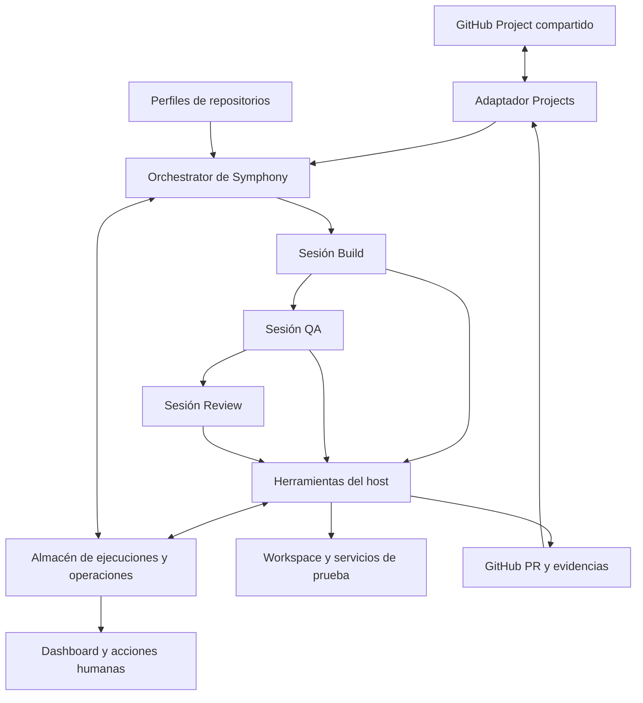

# Plan de implementación de Super Board sobre Symphony

**Proyecto:** [Compralaentrada/symphony](https://github.com/Compralaentrada/symphony)  
**Estado:** propuesta de implementación para revisión  
**Fecha:** 20 de octubre de 2026  
**Base inspeccionada:** `be10a1b79df723d6d7612b5651c8522704dafb2e`

El fork convertirá Symphony en un servicio capaz de tomar tareas de un tablero compartido, ejecutarlas en el repositorio adecuado y conducirlas por Build, QA y Review hasta una entrega verificable. El objetivo operativo es que las tareas terminen o comuniquen un bloqueo concreto, conservando el trabajo cuando falle una dependencia o se reinicie el servicio.

La implementación parte del motor Elixir y Codex de Symphony. La capa de producto, la integración con el tablero y el pipeline se construirán en el fork. Super Board será la referencia funcional para las skills y sus criterios de calidad. El manager anterior queda fuera de la implementación y de sus dependencias.

GitHub Projects es la opción propuesta para el tablero común. Los seis repositorios actuales formarán parte del mismo sistema; cada uno tendrá un perfil de entorno, skills, comprobaciones y política de entrega.

## 1 Objetivo y criterios de éxito

Una tarea admitida debe producir una PR con cambios y evidencias, una conclusión verificable de que no requiere cambios, o una pregunta o bloqueo que permita actuar a una persona. Terminar un turno del modelo o cerrar un proceso no equivale a terminar la tarea.

El sistema debe permitir:

- Gestionar todos los repositorios desde el mismo tablero, con vistas por repo y estado.
- Ejecutar Build, QA y Review con sesiones y responsabilidades diferenciadas.
- Aplicar las reglas del repositorio sin introducir un flujo manual diferente para cada tecnología.
- Reanudar tras un reinicio desde el último resultado confirmado, conservando ramas, artefactos y decisiones.
- Mostrar por qué una tarea avanza, espera o se bloquea, con un siguiente paso concreto.
- Limitar concurrencia, intentos, tiempo y consumo acumulado.
- Incorporar posteriormente recogida de incidencias, refinado de UI, visualizaciones y automatización de merge.

La primera demostración útil será una tarea real que complete el recorrido hasta una PR revisable sin reparar manualmente el ejecutor entre fases. Después se comprobarán dos repositorios en el mismo tablero y la recuperación ante fallos.

## 2 Decisiones de partida

| Asunto | Dirección propuesta | Alcance |
| --- | --- | --- |
| Base | Fork existente de Symphony y referencia Elixir | Mantener transporte Codex, supervisión OTP, workspaces y observabilidad que sigan siendo válidos. |
| Tablero | Un GitHub Project de la organización | Una issue en el repo correspondiente; vistas compartidas y filtradas. |
| Ejecución | Un servicio Symphony con registro de repositorios | Un scheduler propietario de las tareas y procesos de agente por fase. |
| Pipeline | Build → QA → Review | Los resultados validados gobiernan el avance y los rebotes. |
| Skills | Catálogo versionado de Super Board y skills específicas de cada repo | Cargar las necesarias por fase y capacidades, con su procedencia. |
| Persistencia | Almacén transaccional local para la primera versión | SQLite es la propuesta para un servicio en un host; concretar librería y copias antes de implementar. |
| Entrega inicial | PR en borrador y decisión humana de merge | La revisión automática forma parte del pipeline. |
| Paralelismo inicial | Un agente global | La arquitectura admite varios repos; aumentar el paralelismo tras validar la recuperación. |
| Idioma | Español para títulos, explicaciones e informes | Mantener código, identificadores, comandos y nombres técnicos cuando corresponda. |

La elección de almacenamiento, el Project concreto, el host y el modo de merge definitivo requieren concreción. Los valores anteriores permiten diseñar una primera implementación sin convertir cada detalle en un bloqueo.

## 3 Base disponible y extensiones necesarias

Symphony ya incorpora sondeo y reconciliación de tareas, límites por proceso, reintentos, workspaces, sesiones de Codex mediante `app-server`, ejecución remota por SSH y un dashboard Phoenix. La referencia inspeccionada tiene adaptadores para varios trackers. Su adaptador GitHub trabaja con issues `open/closed` de un repo y no consume las columnas de Projects v2. [SY1], [SY2], [SY3]

El fork necesita añadir:

1. Un adaptador Projects que resuelva el item, la issue, el repositorio y el estado del tablero.
2. Un registro de perfiles de repositorio y una configuración efectiva inmutable por intento.
3. Un pipeline explícito con contratos de resultado entre Build, QA y Review.
4. Persistencia de ejecuciones, esperas, evidencias y operaciones externas pendientes.
5. Herramientas del host para checks, publicación, estado del tablero y entrega.
6. Acciones operativas y diagnóstico comprensible de errores.

Los campos de configuración y los nombres de módulos que siguen son propuestas del fork. No deben tratarse como opciones que el Symphony actual ya acepte.

## 4 Arquitectura del servicio



El orquestador existente conserva el control del trabajo. La lógica del pipeline se incorpora a sus decisiones de despacho y finalización; no se introduce otro bucle que compita por ejecutar las mismas tareas.

Cada ejecución captura el perfil del repo, las versiones de skills y herramientas, la rama base y sus SHA. Build, QA y Review reciben ese contexto explícito. Las lecturas globales de configuración que existen hoy deben revisarse en `AgentRunner`, `PromptBuilder`, `Workspace` y `Codex.AppServer`: cambiar una variable global antes de arrancar un agente no ofrece aislamiento entre repositorios concurrentes. [SY4], [SY5], [SY6], [SY7]

Se empezará con un host y un almacén de escritura. Los workers remotos y varias máquinas coordinadoras se habilitarán cuando el protocolo de propiedad de ejecución esté probado. El soporte SSH upstream no implica que la afinidad por repo y plataforma esté resuelta.

## 5 Tablero común y modelo de tarea

### Estados visibles

Se conserva el tablero de siete columnas de Super Board: **Backlog, Ready, Building, QA, Review, Blocked y Done**. [SB1]

| Columna | Significado | Condición para actuar |
| --- | --- | --- |
| Backlog | Trabajo recogido que aún no está admitido | No ejecuta agentes. |
| Ready | Petición de ejecución o reanudación | Exige repo registrado, criterios y perfil válidos. |
| Building | Implementación en curso | Debe existir un intento propietario y contexto de código. |
| QA | Verificación o análisis de huecos de pruebas | Usa el SHA de la entrega de Build. |
| Review | Revisión automática o espera de decisión humana | El subestado persistido distingue ambas situaciones. |
| Blocked | Falta información, acceso o una decisión | Debe mostrar motivo y acción para desbloquear. |
| Done | Entrega confirmada o resolución explícita sin entrega | Requiere comprobar la condición de cierre. |

**Review no será por sí sola una orden para lanzar otro reviewer.** El registro de ejecución distinguirá `reviewing` y `awaiting_human_review`. La espera humana libera el slot y persiste tras reiniciar. El dashboard y un campo de resultado del tablero harán visible esta diferencia.

### Identidad y campos

La identidad estable contendrá `project_id`, `project_item_id`, `issue_node_id` y `repository_id`. La referencia humana será `owner/repo#number`. Cambiar el título, renombrar el repo o repetir `#42` en otro repositorio no debe crear una ejecución incorrecta. La branch y el workspace incluirán un identificador único del intento.

Campos mínimos: Status, repositorio asociado a la issue, prioridad, tipo, riesgo, responsable, PR y resultado de ejecución. Conservar `bug`, `feature` y `qa` permite reproducir la clasificación de Super Board; una tarjeta `qa` comienza en QA y no crea una implementación ficticia. [SB1]

Las ideas sin issue pueden permanecer en Backlog. Para pasar a ejecución deben convertirse en una issue con repo inequívoco. Un item PR se vincula como resultado; no se interpreta automáticamente como una nueva tarea de implementación.

### Autoridad y sincronización

El tablero expresa el estado de trabajo y la intención humana. El almacén de ejecuciones es la autoridad de los intentos, las fases y los efectos confirmados. Un estado visible no sustituye la evidencia que exige su transición.

Mover a Ready solicita una nueva generación de trabajo; no invalida por sí solo una PR ni autoriza repetir efectos ya realizados. Mover una tarea activa a Blocked o Backlog solicita parar: el host cancela el proceso, conserva el trabajo y confirma la parada. Mover manualmente a Done durante una ejecución requiere reconciliar o detener el intento; no permite asumir que la PR se fusionó.

Una indisponibilidad de GitHub mantiene el estado conocido y limita los efectos nuevos. Las lecturas paginadas incompletas, permisos insuficientes o respuestas GraphQL con errores no equivalen a un tablero vacío.

El adaptador usará los IDs reales de campos y opciones. Resolverlos por nombre sirve para onboarding, pero una vez configurados se validan; no se crean columnas ni se migran tareas silenciosamente al arrancar. Projects permite consultar items y mutar campos mediante GraphQL. [GH1]

## 6 Registro de repositorios y configuración

Un perfil por repo declarará su identidad remota, rama base, runtime, preparación del entorno, capacidades, comprobaciones, skills y política de entrega. Evitar rutas específicas del portátil como parte de la configuración compartida.

Estructura propuesta, pendiente de implementar:

```text
WORKFLOW.md                         configuración común y contrato de despacho
config/repositories/*.yaml          perfiles de repositorios
skills/*/SKILL.md                   skills portadas
skills/catalog.lock.json            procedencia y revisiones fijadas
docs/superboard-symphony-plan.md     especificación de producto
```

El archivo de bloqueo registra SHA y huella de contenido; no instala skills por similitud de nombre. Las credenciales y los datos de ejecución se guardan fuera del repositorio.

Ejemplo conceptual de perfil; este esquema no existe todavía en upstream:

```yaml
schema_version: 1
repository: Compralaentrada/vue.teatros-clubs
base_branch: master
workspace_strategy: isolated_clone
runtime_profile: vue-node22
phases:
  build: { skill: super-build }
  qa: { skill: super-qa }
  review: { skill: super-review }
checks_profile: vue-impact-scoped
delivery:
  pull_request: draft
  merge_policy: human
limits:
  max_active_runs: 1
```

No se ejecutan comandos interpolados desde el título de una tarea. Los checks se representan como argumentos estructurados, con directorio de trabajo, timeout y entorno permitidos. La configuración efectiva se valida y se guarda por intento antes de ejecutar código.

Precedencia propuesta: invariantes del host → política organizativa → perfil del repo → reglas de desarrollo del repo → instrucciones específicas de la tarea. Las reglas del repositorio pueden exigir más comprobaciones; una contradicción material con el perfil bloquea admisión con un diagnóstico. El contenido de una issue no modifica permisos del ejecutor.

Al recargar configuración, los intentos activos conservan su snapshot. Una petición explícita de parada o una revocación de acceso sí debe poder cancelarlos. Esto exige separar recarga rutinaria de revocación operativa.

## 7 Contrato del pipeline

### Admisión y preparación

Antes de gastar un turno de implementación, el host comprueba repo y rama base, acceso necesario, disponibilidad de skills y herramientas, estado del workspace, dependencias de la tarea y perfil de checks. La comprobación de aceptación determina si se puede trabajar, si otra PR ya resuelve el problema o si falta información.

La deduplicación usa identidad de tarea y PR vinculada; los candidatos similares requieren interpretación. Una coincidencia de palabras no cierra automáticamente un bug. Las dependencias entre repos se resuelven por identidad completa, no por números locales.

Los fallos de entorno se comunican con comando o recurso afectado y solución propuesta. No se transforma un fallo del ejecutor en una devolución al Builder para que reescriba código del producto.

La tarea conserva un formato común: problema, contexto, cambio esperado, criterios de aceptación, riesgo y dependencias. Los criterios deben ser observables. La operación equivalente a `super-board lint` revisa esa preparación; no ejecuta el linter del lenguaje. Las tareas ya clasificadas como documentación, refactor o tests conservan su clasificación sin forzar `feature` o `bug`. [SB6], [SB7]

### Build

El Builder recibe la tarea y sus criterios, instrucciones del repo, skills resueltas y contexto del intento. Implementa en su workspace, añade las pruebas pertinentes y usa herramientas del host para registrar checks y publicar una PR en borrador cuando exista una entrega útil.

Su salida incluye resumen, criterios cubiertos, SHA de código, archivos cambiados, pruebas propuestas o ejecutadas, riesgos y bloqueos. El host verifica branch y SHA y confirma la publicación. Un mensaje del modelo que diga «PR creada» no acredita ese efecto.

Si no hacen falta cambios, se exige una explicación con evidencias. Una persona confirma la resolución cuando no haya una condición determinista configurada. No se fabrica una PR vacía.

### QA

QA comienza en una sesión nueva y recibe el código identificado por SHA, los criterios y los artefactos de Build. Reproduce los checks aplicables, revisa huecos de pruebas y recoge evidencia de UI cuando la tarea la requiera.

El perfil distingue fallos, resultados inestables, pruebas omitidas justificadas y comprobaciones no disponibles. Una comprobación obligatoria no ejecutada no pasa a verde. La deuda previa se separa de regresiones relacionadas con el cambio mediante evidencia reproducible; no basta atribuir un fallo a que «ya estaba».

Los defectos se devuelven a Build con IDs estables, reproducción y criterio incumplido. Cuando Build cambia el código se genera una nueva entrega y QA valida ese nuevo SHA. Las pruebas añadidas en QA también forman parte de la entrega y actualizan su identidad.

El análisis de huecos relaciona criterios con aserciones concretas y rutas de prueba. Considera casos de error, permisos, dinero, límites, concurrencia y estados de UI cuando apliquen. Un test que solo confirma su propio mock no demuestra el comportamiento del producto. Los huecos de severidad alta deben justificarse con un escenario concreto; los de menor riesgo se registran sin convertir toda mejora posible en un bloqueo. [SB8]

### Review

El Reviewer usa otra sesión y comienza por criterios y diff para formular sus hipótesis. Después contrasta los informes previos, revisa los hallazgos abiertos y comprueba si las correcciones están presentes.

Los hallazgos conservan identidad, severidad, ruta o líneas y evidencia. Cada pasada declara cuáles se resolvieron, siguen pendientes o dejaron de aplicar. No se sobrescriben hallazgos sin conservar su resolución.

El pase adversarial de Super Board se conserva para tareas de mayor riesgo o reglas definidas por perfil. Varias pasadas del mismo modelo no se presentan como garantía de independencia. La separación de sesiones reduce el arrastre de contexto y no sustituye los checks del host.

Las categorías de hallazgo incluyen bug, criterio sin cubrir, verificación omitida, desviación de alcance y complejidad innecesaria. Una preferencia de estilo arquitectónico no provoca por sí sola un rebote indefinido. La severidad debe vincularse al impacto o al criterio incumplido. [SB9]

### Entrega y cierre

Con QA y Review aceptados, el sistema guarda una entrega revisable vinculada a `head_sha`, `base_sha`, configuración y versiones de skills. El modo inicial deja la PR en borrador y la tarea en Review con subestado de espera humana.

Si se habilita merge automático posteriormente, una política explícita decide su admisión por repo y riesgo. El host vuelve a comprobar evidencia, aprobación cuando corresponda, HEAD remoto, checks requeridos y base antes del merge. Cualquier cambio relevante invalida la aprobación y los resultados afectados.

Done exige confirmar el merge y su presencia en la rama destino. Los descartes se cierran con una resolución distinta de entrega completada; se puede conservar Done como columna final mostrando `dropped`, tal como contempla Super Board. [SB1]

### Tabla de transiciones

| Desde | Evento validado | Siguiente estado | Responsable |
| --- | --- | --- | --- |
| Ready | Admisión y claim confirmados | Building o QA para tipo `qa` | Orquestador |
| Building | Entrega y contexto de código válidos | QA | Host y pipeline |
| QA | Checks y criterios aceptados | Review con subestado `reviewing` | Pipeline |
| QA o Review | Defecto de implementación | Building con hallazgos abiertos | Pipeline |
| Review | Revisión aceptada | Review con subestado `awaiting_human_review` | Pipeline |
| Cualquier fase activa | Falta información o acceso | Blocked con motivo persistido | Host y pipeline |
| Blocked | Respuesta o reparación confirmada | Fase pendiente del mismo intento o nueva generación | Orquestador |
| Review | Merge confirmado o resolución de cierre aceptada | Done | Host |

Las fases se implementarán en código con transiciones admitidas. No deben depender de que una skill recuerde cambiar una columna ni del exit code del proceso Codex.

### Resultado estructurado de fase

Cada rol entrega un resultado que el host valida contra un esquema versionado. Ejemplo conceptual de una salida QA; los valores de identidad y evidencia deben corresponder a registros existentes:

```json
{
  "schema": "symphony-phase-result/v1",
  "run_id": "run-unique-id",
  "generation": 1,
  "phase": "qa",
  "repository": "Compralaentrada/vue.teatros-clubs",
  "head_sha": "full-commit-sha",
  "base_sha": "full-base-sha",
  "config_digest": "effective-config-digest",
  "outcome": "passed",
  "summary": "Criterios verificados en la entrega indicada",
  "evidence_ids": ["check-record-id"],
  "findings": [],
  "questions": []
}
```

Resultados admitidos: `passed`, `changes_requested`, `needs_input` y `blocked`. Una respuesta malformada es un error de contrato, con corrección acotada; no una aprobación. Los checks e IDs de evidencia deben provenir del host, y un resultado aprobado debe cubrir los requisitos del rol. Las preguntas, los hallazgos y el resumen tienen límites de tamaño. Ningún resultado permite al modelo autoconcederse permisos o marcar Done directamente.

## 8 Skills y herramientas de Super Board

El catálogo upstream inspeccionado contiene ocho skills: cinco de uso directo y tres de pipeline. El fork debe conservar su cobertura funcional con una adaptación explícita al host Symphony. [SB2]

| Skill | Función en el fork | Adaptación |
| --- | --- | --- |
| `super-board` | Política general, admisión y operación del pipeline | Extraer decisiones verificables al código y mantener la guía de trabajo. |
| `super-build` | Implementación por criterios y entrega | Reemplazar scripts de manager y mutaciones directas por herramientas del host. |
| `super-qa` | Checks, huecos de pruebas y evidencias | Integrar perfiles por repo, navegador y contratos de resultados. |
| `super-review` | Revisión, hallazgos persistentes y validación de correcciones | Separar sesión, conclusiones del modelo y autorización de entrega. |
| `super-collect` | Recogida, verificación y deduplicación de problemas | Conectores posteriores que crean Backlog, sin activar trabajo por sí mismos. |
| `ui-refine-loop` | Ciclo de crítica y mejora de una pantalla o componente | Flujo optativo iniciado expresamente, con navegador, evidencia y límite de iteraciones. |
| `visual` | Explicación o mapa visual de planes y cambios | Artefacto enlazado a la tarea y mantenido fuera de decisiones de autorización. |
| `git-sync` | Sincronización de cambios y ramas | Operaciones acotadas al repo y branch del intento; publicación controlada por host. |

Las skills externas se resuelven por capacidad: framework, pruebas, frontend, diseño, diagnóstico o revisión. El catálogo fija origen, revisión, licencia, huella y fases compatibles. Los fallbacks deben estar declarados y ser funcionalmente válidos. Si falta una skill obligatoria, la tarea espera una reparación de readiness; no se inventa una skill equivalente ni se descarga código durante la ejecución sin control.

Las instrucciones del repo se descubren en cada checkout. Una actualización de skills se prueba con tareas representativas y se aplica a nuevos intentos. QA y Review pueden reproducir una ejecución con las mismas versiones de la entrega original.

La resolución distingue skills obligatorias, condicionales, opcionales e interactivas. Un worker desatendido no carga una skill que exige diálogo interactivo para completarse. Readiness debe comprobar la skill efectiva y su contrato; el resolver upstream comprueba disponibilidad, pero el pin de revisiones es una extensión del fork. [SB10]

Los comandos de Super Board son referencia de experiencia de uso, no una obligación de conservar su implementación shell. El fork debe cubrir onboarding, ejecución, estado, parada, clasificación, calibración y limpieza, además de las operaciones directas de las skills. La matriz de paridad del apartado 16 mantiene visibles las capacidades pendientes.

| Interfaz observada en Super Board | Equivalente funcional en el fork |
| --- | --- |
| `onboard` | Registrar y validar repo, herramientas y acceso al Project. |
| `lint` | Revisar claridad de tareas y criterios de admisión. |
| `status` | Consultar fase, progreso, PR y bloqueos. |
| `run` y reanudación mediante `run` | Activar admisión o solicitar continuación controlada. |
| `stop` | Detener trabajo conservando contexto y artefactos. |
| `run --low`, `--high`, `--codex` y modelo explícito | Perfil de modelos y presupuesto por rol, validado por el host. |
| `super-collect` con fuentes y `--since` | Intake acotado por origen y periodo, con previsualización antes de publicación. |
| `visual recap`, `plan` y `map` | Artefactos de explicación y exploración vinculados a la tarea. |

`ui-refine-loop` no se dispara automáticamente desde las fases del board en upstream; su incorporación conserva la activación explícita. `git-sync` es una utilidad optativa y no el cierre automático de cualquier tarea. [SB6], [SB11], [SB12], [SB13]

### Formato de los entregables

Los informes de Build, QA y Review usan bloques identificables por rol, sin sobrescribir contenido humano. El título y cuerpo de la PR explican problema, cambio, criterios, evidencias y limitaciones concretas. Los comentarios de estado comunican rol, resultado y siguiente acción sin convertir el hilo en un volcado de logs.

El estándar de escritura de Super Board aporta plantillas, pero el perfil del repo conserva las convenciones necesarias para su automatización de releases. Un formato de commit con prefijos adicionales debe comprobarse frente a herramientas como release-please antes de adoptarlo. [SB7]

## 9 Herramientas que ejecuta el host

Las siguientes operaciones son contratos propuestos, no APIs existentes de Symphony:

| Operación | Qué controla el host | Evidencia de salida |
| --- | --- | --- |
| Preparar workspace | Repo autorizado, branch, ruta canónica y entorno | Identidad del workspace y SHA base. |
| Ejecutar check | Comando permitido, timeout, entorno y captura de salida | Inicio, fin, exit code, resultado y archivos de evidencia. |
| Publicar entrega | Branch del intento, cambios y remoto correcto | Commit y confirmación de push. |
| Crear o actualizar PR | Repo, branch, base y marcador del intento | ID y URL consultados en GitHub. |
| Solicitar transición | Resultado de fase y estado esperado | Transición aceptada o razón de rechazo. |
| Pedir aclaración | Pregunta concreta y relación con la tarea | Espera persistida y punto de reanudación. |
| Registrar revisión | SHA revisado y hallazgos estructurados | Informe y revisión verificables. |
| Fusionar | Política, aprobación y contexto de código | Merge confirmado y rama destino comprobada. |

El agente puede proponer una acción; el host valida el contexto y ejecuta sus efectos. Un wrapper no constituye una barrera si el agente mantiene shell y credenciales con las que puede saltárselo. El perfil de aislamiento debe hacer efectivas las restricciones que se prometen.

Las herramientas base incluyen Git, Codex `app-server`, acceso API GitHub y runtimes del repo. GitHub CLI puede servir para diagnóstico o como transporte inicial encapsulado; las mutaciones del producto no se reparten entre scripts independientes sin contratos comunes.

Browser y Playwright son capacidades para QA de UI; las conexiones a Nightwatch, Sentry, PostHog, Asana y otros MCP son opcionales por perfil. Cada integración necesita operaciones y credenciales concretas. El código no debe asumir que un plugin de esta conversación existe en el host donde se despliegue el servicio.

El crawler de QA, la exploración de recorridos de varias pantallas, el verificador funcional del proyecto y los checks de rendimiento y memoria son capacidades separadas. Se habilitan por perfil cuando hay un entorno y criterios reproducibles. Una página vacía, una pantalla de login o un backend caído no cuentan como verificación de una pantalla del producto. [SB8]

## 10 Persistencia y recuperación

### Datos mínimos

| Registro | Contenido y propósito |
| --- | --- |
| Tarea | Identidad global, repo, última intención del tablero y generación admitida. |
| Ejecución | Fase, estado, contexto de código, propietario, límites, configuración y motivo de espera. |
| Intento de fase | Sesión, inicio y fin, resultado, error y consumo. |
| Evidencia | Entrega y SHA asociados, check, revisión y ubicación de artefactos. |
| Operación externa | Intención, clave estable, estado de confirmación y referencia remota. |

El primer almacén debe ofrecer transacciones y restricciones de unicidad. Puede implementarse con SQLite en el host único; sus ficheros y artefactos requieren volumen persistente, copia y restauración. No se incluye un bus de eventos ni una cola distribuida como requisito inicial.

### Propiedad de ejecución

Debe existir como máximo un intento activo por tarea y generación. Un token de propiedad impide que un proceso antiguo publique resultados después de que otro haya recuperado su trabajo. El contador de concurrencia incluye Build, QA y Review; las esperas humanas liberan capacidad.

Al reiniciar, el servicio reconcilia procesos vivos, registros, workspaces, branches y efectos remotos. No supone que un proceso desaparecido falló antes de hacer cambios, ni que un proceso que terminó correctamente completó la tarea.

Una sesión de Codex puede continuar si el protocolo y sus datos lo permiten. Si no, se abre una nueva sesión desde el último checkpoint confirmado, con la conversación resumida y las evidencias. La garantía del fork será recuperar el trabajo, no prometer restauración exacta de toda conversación sin haberla implementado. Los bloqueos upstream se guardan en memoria y necesitan persistencia adicional. [SY2], [SY8]

### Operaciones externas e idempotencia

Antes de crear una PR o cambiar un estado externo se registra una intención durable. Cada operación usa una clave que incluya tarea, generación, fase y tipo de efecto. Si una respuesta se pierde, el reconciliador consulta el estado remoto antes de decidir si la operación se realizó.

No se promete atomicidad entre GitHub y la base local. Una PR se reconoce por repo, branch y marcador del intento; una publicación se reconoce por su SHA remoto. Las actualizaciones de informes usan bloques propios para evitar duplicados y conservar comentarios humanos.

Las operaciones confirmadas no se repiten al reanudar. Un worker que perdió su token de propiedad no puede aprobar una transición ni publicar mediante herramientas del host.

### Política de errores

| Error | Tratamiento |
| --- | --- |
| Lectura temporal de GitHub o límite de API | Backoff con demora del proveedor, sin interpretar vacío ni perder estado. |
| Mutación con respuesta incierta | Estado de reconciliación; consultar antes de repetir. |
| Herramienta o autenticación ausente | Bloqueo operativo visible; no bucle de implementación. |
| Fallo de test relacionado | Hallazgo QA y vuelta a Build con evidencia. |
| Check no disponible | Espera o decisión humana según perfil; nunca PASS ficticio. |
| Proceso interrumpido | Conservar workspace y reconciliar sesión y efectos. |
| Falta de avance o agotamiento de límites | Parar con resumen, último checkpoint y opciones de continuación. |
| Cambio de HEAD durante QA o Review | Invalidar evidencia afectada y revisar la nueva entrega. |

Los límites acumulados incluirán intentos de fase, rebotes, tiempo total y tokens. Si no hay precio verificado para un modelo, se controla consumo por tokens; no se publica un coste monetario inventado. Los límites de turnos de una sesión upstream no bastan como presupuesto de toda la tarea. [SY8], [SY9]

El esquema debe exigir límites finitos o aplicar defaults explícitos y finitos. El contador no vuelve a cero al reiniciar el servicio ni al cambiar de modelo. La política distinguirá reintentos de infraestructura y ciclos de corrección del producto para que un fallo externo no consuma indefinidamente turnos de Build.

## 11 Workspaces y entornos por repositorio

Para la primera versión se propone un clon aislado por ejecución. Facilita separar permisos y directorios Git; el caché de descarga puede compartirse como recurso de lectura controlado. Los worktrees de un clon común pueden evaluarse posteriormente, comprobando acceso al Git common dir y hooks.

La ruta combina repo, identidad de tarea y generación. Ningún agente trabaja en el checkout habitual. El bootstrap resuelve versiones y dependencias antes de comenzar, con manifiestos fijados y un resultado de readiness. No se reutilizan dependencias de otra rama si sus manifiestos no coinciden.

Los servicios de prueba pertenecen al entorno de ejecución. Bases de datos, puertos, procesos web y artefactos no pueden colisionar entre tareas concurrentes. Las pruebas nunca reciben una base de producción por defecto. El nombre `local` de un archivo o una variable no demuestra aislamiento: el bootstrap valida el destino efectivo.

La limpieza ocurre después de confirmar los efectos y guardar evidencias. Las tareas bloqueadas o interrumpidas conservan trabajo; la retención posterior tiene plazo y comando de recuperación. Un fallo de limpieza se muestra como fallo operativo distinto del resultado del producto.

Los hooks upstream `after_run` y `before_remove` ignoran sus errores tras registrarlos: los checks que deciden aceptación deben ejecutarse como pasos obligatorios del pipeline. [SY6]

## 12 Adaptación a los seis proyectos

| Repo | Perfil y comprobaciones a concretar | Particularidades |
| --- | --- | --- |
| `vue.teatros-clubs` | Vue 2.7, Node 22 declarado, unit tests y checks por impacto | Resolver lint y deuda previa conforme al perfil; Playwright necesita UI y backend de ensayo cuando aplique. |
| `nuxt.compralaentrada-admin` | Nuxt 2, runtime compatible con lockfile, pruebas Node y build | Hay pruebas `node:test` aunque no exista un script `test`; definir cobertura y validación de UI por tarea. |
| `laravel.api-backend` | Laravel 11 y PHP compatible con el proyecto | PHPUnit Unit y Feature usa SQLite en memoria; suite MySQL y Redis es optativa y separada. |
| `laravel.comunicados-backend` | Laravel 12 y entorno de PHP y PostgreSQL de prueba | Respetar el bootstrap, los seeders y el uso de PostgreSQL que exige el proyecto. |
| `laravel.asana-bridge` | Laravel 12, Livewire y pruebas PHP y Node del worker | Se gestiona como repo de producto; no se usa como motor de este fork. |
| `flutter_kiosko_compralaentrada` | Flutter y Dart fijados, análisis, unit y widget con fakes | macOS y Windows, impresora y terminal de pago requieren verificaciones de plataforma y smoke específicos. |

Los comandos concretos se extraerán de los archivos vigentes de cada repo al implementar su perfil. La prueba del propio fork usará los requisitos de `elixir/AGENTS.md`; los checks de los productos usarán sus reglas y herramientas.

Una tarea que afecte a API, administración y kiosco se divide en subtareas por repo vinculadas a una épica común. Las dependencias expresan orden y contratos compatibles; no se promete una transacción de merge entre repositorios. La entrega incluye la compatibilidad del cambio durante el despliegue progresivo.

## 13 Aislamiento y controles de entrega

Los permisos se separan entre servicio y ejecución: el host conserva las credenciales de Projects y publicación; los agentes reciben solo las capacidades necesarias para trabajar y verificar. El entorno de los procesos hijo se construye expresamente. Eliminar las variables conocidas de tracker, como hace upstream, no garantiza por sí solo que otras credenciales del host sean inaccesibles. [SY7]

Los límites efectivos deben cubrir rutas canónicas y symlinks, `.git`, ramas autorizadas, acceso a servicios de prueba y red requerida. Las ramas protegidas no reciben pushes directos. Los hooks shell se ejecutan con permisos del host: su contenido debe proceder de configuración revisada y no de la tarea.

Los hooks de Super Board son filtros de su host original y no se trasladan como garantía de autorización. Los invariantes del fork se comprueban en código y con el aislamiento real del proceso.

El modo de merge se declara por repo. En modo humano, el sistema ofrece el resultado y espera; en modo automático, el host aplica el gate. Una aprobación identifica repo, PR, HEAD revisado, base validada y política efectiva. Si cambia el código, se invalida la aprobación correspondiente.

Las protecciones y checks de GitHub completan el control de integración. Un mutex local y un pin del HEAD no impiden por sí solos que otro actor mueva la base remota; la estrategia de merge debe incluir validación actualizada o cola de merge. [SB3], [SB4]

La aprobación también identifica el alcance de operaciones autorizado. Una etiqueta del tablero no equivale a una aprobación de merge. El fallo del mecanismo que valida permisos o evidencia impide ejecutar la mutación protegida. Los filtros de hooks upstream que continúan ante errores propios no proporcionan ese contrato. [SB4], [SB14]

## 14 Operación y observabilidad

El tablero es la superficie principal de tareas. El dashboard Symphony explica la ejecución: repo, fase, subestado, intento, duración, consumo, PR, último resultado y siguiente acción. Las esperas humanas y la reconciliación deben ser distinguibles de un agente activo.

Acciones propuestas para el operador: pausar admisión global o por repo; parar una ejecución; responder una aclaración; reanudar desde checkpoint; reintentar una fase después de reparar el entorno; consultar evidencias; aprobar o rechazar una entrega según política; y solicitar limpieza de un workspace ya retenido.

Cada acción valida identidad, estado esperado y token de revisión, y deja registro. El router actual solo ofrece observabilidad y refresh; estas operaciones necesitan endpoints nuevos y control de acceso. No se expone una consola de mutaciones en una red compartida sin autenticación. [SY10]

Los logs incluyen task, repo, run, fase, intento, sesión y operación. Se conservan los errores originales de herramientas y un resumen legible. Los tokens y datos sensibles se eliminan de informes y logs. Para gestionar fallos, el mensaje debe indicar qué ocurrió, dónde quedó el trabajo y qué permite continuar.

El onboarding valida herramientas y acceso antes de activar el repo. Su modo de diagnóstico es de lectura; las correcciones que instalen herramientas, creen campos o cambien configuración son acciones explícitas con resultado comprobable.

### Intake de incidencias

Los conectores normalizan candidatos conservando repo, fuente, referencia y evidencia. Distinguen lectura correcta, vacío, truncado y no disponible. Antes de publicar, un verificador comprueba vigencia del problema y posibles arreglos. El fingerprint incluye repositorio, fuente y causa; se consulta el historial para adoptar una tarea existente o enlazar una recurrencia sin duplicarla indiscriminadamente.

El modo inicial ofrece previsualización. La publicación crea o actualiza Backlog y nunca concede por sí sola admisión a ejecución. Nightwatch y Asana se implementan como fuentes propias si se eligen; no se presentan como conectores nativos ya disponibles de Super Board. [SB15]

## 15 Mantenimiento del fork

La implementación mantendrá módulos acotados alrededor de las fronteras existentes, sin reescribir el transporte Codex ni todos los trackers como parte del primer objetivo.

| Área | Frontera existente | Extensión propuesta |
| --- | --- | --- |
| Tracker | `tracker.ex`, `tracker/issue.ex`, `github/adapter.ex` y `github/client.ex` | Adaptador Projects e identidad global con referencia nativa. |
| Configuración | `workflow.ex`, `workflow_store.ex`, `config.ex`, `config/schema.ex` | Perfiles validados y snapshot efectivo por intento. |
| Planificación | `orchestrator.ex` | Elegibilidad por pipeline, contexto de repo y finalización de fase. |
| Agente | `agent_runner.ex`, `prompt_builder.ex`, `codex/app_server.ex` | Sesión por rol y contexto explícito, validación del contrato de resultado. |
| Workspace | `workspace.ex` y utilidades de rutas | Preparación por repo y recuperación de artefactos. |
| Herramientas | `codex/dynamic_tool.ex` y herramientas de tracker | Operaciones del host con contexto e idempotencia. |
| Operación | `symphony_elixir_web/*` | Vista de ejecución y acciones autenticadas. |
| Persistencia | Módulo nuevo acotado | Ejecuciones y operaciones pendientes con transacciones. |

Los nombres concretos de módulos nuevos se decidirán al dividir el trabajo. No hace falta introducir un framework de plugins, múltiples bases de datos ni una infraestructura de colas para completar el primer ciclo.

Mantener `origin` para el fork y `upstream` para OpenAI, registrar la revisión base y actualizar de forma deliberada. Cada cambio de contrato debe actualizar documentación y, cuando proceda, la SPEC del fork. Las modificaciones del orquestador exigen considerar arranque, reload, reinicio y recuperación conjuntamente. [SY11]

Conservar Apache 2.0 y NOTICE de Symphony; conservar MIT y atribuciones del código copiado de Super Board. Registrar individualmente las licencias de skills y dependencias externas. [SY12], [SB5]

## 16 Matriz de paridad y fases de entrega

| Capacidad de Super Board | Entrega prevista | Condición de aceptación |
| --- | --- | --- |
| Tablero y pipeline de siete columnas | Núcleo inicial | Una tarea recorre fases sin acciones manuales de reparación. |
| Builder, QA y Reviewer | Núcleo inicial | Sesiones distintas y resultados asociados al código. |
| Readiness y skills por tarea | Núcleo inicial | Dependencia ausente produce diagnóstico y conserva estado. |
| PR en borrador e informes | Núcleo inicial | Publicación comprobada y sin duplicados al reintentar. |
| Rebotes y memoria de hallazgos | Robustez del pipeline | Review identifica qué hallazgos se resolvieron en cada entrega. |
| Tipo `qa` sin Build | Robustez del pipeline | Verifica producto existente sin fingir implementación. |
| Dependencias, prioridades y tandas | Extensión de planificación | Tareas de repos distintos se ordenan sin colisión de identidad. |
| Límites y detección de falta de avance | Núcleo y endurecimiento | La ejecución se detiene con un checkpoint recuperable. |
| Política humana y gate de merge | Modo humano inicial y automatización posterior | Un cambio de SHA invalida evidencia y aprobación afectadas. |
| Calibración y graduación de autonomía | Posterior al piloto | Se basa en resultados registrados y reglas explicables. |
| Intake `super-collect` | Después del ciclo fiable | Incidencia verificada y deduplicada entra en Backlog. |
| Sentry, PostHog, arquitectura, PR y fuentes custom | Conectores progresivos | Cada origen tiene contrato de lectura, verificación y deduplicación. |
| Nightwatch y Asana de la organización | Conectores propios opcionales | Se confirma el acceso y mapping sin duplicar tareas. |
| UI refine loop y evidencias de navegador | Perfil de frontend | Comparación antes y después con límite de iteraciones. |
| Visualizaciones y mapas | Extensión de artefactos | Resultado visible y vinculado a la tarea y entrega. |
| Git sync | Integración acotada | Conserva trabajo y opera sobre branch y repo del intento. |
| Fallback de modelos y cuentas | Posterior al piloto | Selección explícita; conserva límites y no cambia proveedor silenciosamente. |
| Onboarding, status, stop y cleanup | Operación inicial | Permiten diagnóstico, parada y recuperación sin manipular archivos internos. |

### Entrega uno Tarea completa en un repositorio

Implementar perfil, adaptador Projects mínimo, persistencia mínima, Build, QA, Review y PR en borrador. Empezar con una tarea real pequeña y un host. Criterio: evidencia de checks, revisión y PR confirmadas; una nueva encuesta del tablero no reinicia el trabajo ya entregado.

### Entrega dos Recuperación y dos repositorios

Añadir reanudación, aclaraciones, cancelación, reconciliación de operaciones, límites y segundo perfil. Provocar fallos entre una publicación remota y su confirmación local. Criterio: dos tareas `#42` de repos diferentes mantienen ramas, evidencias y resultados separados, y un reinicio no duplica PRs.

### Entrega tres Paridad del pipeline

Completar `qa`, rebotes, historial de hallazgos, dependencias, acciones humanas y configuración de checks por impacto. Ejecutar un piloto de 10 a 20 tareas con criterios definidos. Criterio: tareas aceptadas, bloqueos accionables y tiempo de supervisión registrados; ningún fallo se oculta como éxito.

### Entrega cuatro Todos los repositorios

Añadir los perfiles restantes y las verificaciones de plataforma de Flutter. Subir concurrencia gradualmente con aislamiento de DB y procesos. Criterio: el mismo tablero mantiene control y trazabilidad del conjunto.

### Entrega cinco Extensiones de producto

Incorporar intake, refinado de UI, visualizaciones, calibración y merge automático según prioridades. Cada extensión debe conservar los contratos del pipeline y contar con un criterio de aceptación propio.

## 17 Verificación de la implementación

El documento define las comprobaciones que habrá que construir y ejecutar al implementar. La aceptación debe demostrar comportamiento observable de procesos reales cuando se modifiquen las partes con estado, conforme a las reglas del fork. [SY11]

| Caso | Resultado requerido |
| --- | --- |
| Dos repos con issue `#42` | Identidades, branches, workspaces y PRs independientes. |
| Dos eventos o polls de la misma tarea | Un único intento activo. |
| Fallo al leer una página del Project | No se consideran desaparecidas las tareas ni se borra trabajo. |
| Reinicio durante Build | Recuperación del workspace y del último checkpoint confirmado. |
| Reinicio esperando respuesta humana | La tarea sigue esperando, sin lanzar otro agente. |
| PR creada y respuesta perdida | Se reconoce la PR existente y no se duplica. |
| Proceso viejo entrega resultado | Se rechaza si perdió su token de propiedad. |
| QA falla por un defecto del producto | Devuelve un hallazgo reproducible a Build. |
| QA falla por entorno o acceso | Diagnóstico operativo sin bucle de cambios de producto. |
| HEAD cambia tras QA o Review | Evidencia afectada inválida y nueva validación. |
| Cambio de base antes de merge | Se aplica la política de integración y se revalida cuando sea necesario. |
| Cancelación o parada | El proceso se detiene, libera capacidad y conserva artefactos. |
| Cambio de configuración con una tarea activa | El intento conserva su snapshot salvo revocación explícita. |
| Check omitido o no disponible | No se transforma en resultado aprobado. |
| Symlink fuera del workspace o credencial de host | El aislamiento impide el acceso que el perfil prohíbe. |
| Tarea sin cambios útiles | Resolución justificada y sin PR ficticia. |

Para el código Elixir se usarán checks específicos durante cada cambio y los gates del repositorio antes de entrega: `make all` desde `elixir/` y los contratos documentados en `elixir/AGENTS.md`. La documentación del sistema y sus ejemplos de configuración deben evolucionar en el mismo cambio que los contratos implementados. Este documento, por sí solo, no introduce comportamiento ejecutable.

## 18 Decisiones pendientes antes de implementar

| Decisión | Propuesta inicial | Cuándo cerrarla |
| --- | --- | --- |
| Project de organización | Uno compartido con scope de ensayo inicial | Antes de conectar escrituras. |
| Host y persistencia | Un servicio local o servidor dedicado con volumen durable | Antes del primer despliegue. |
| SQLite y acceso desde Elixir | Elegir dependencia y mecanismo de migraciones compatibles con el fork | Al diseñar el almacén mínimo. |
| Primer repo | Vue o Laravel con tarea pequeña y entorno reproducible | Antes de la primera demostración. |
| Modelos por fase | Configurables; sesiones separadas | Antes del primer turno real. |
| Checks de cada repo | Perfiles derivados de sus reglas y entornos | Antes de admitir tareas de ese repo. |
| Merge y aprobación | Humano inicialmente; automatización por política posterior | Antes de habilitar cada modo. |
| Acceso al dashboard | Local inicialmente; autenticado antes de acceso compartido | Antes de habilitar acciones remotas. |
| Destino de artefactos y retención | Volumen persistente y enlaces desde la ejecución | Con la primera entrega de evidencias. |
| Prioridad de conectores adicionales | Después del pipeline fiable | Tras el piloto. |

La estimación detallada debe realizarse al convertir estas entregas en tareas con alcance y aceptación. La cifra preliminar de viabilidad no sustituye un plan de implementación de persistencia, herramientas y recuperación.

## 19 Fuentes y referencias

Las referencias a Symphony fijan el commit base del fork. Las de Super Board fijan el código inspeccionado, posterior a su release v3.1.2. Las secciones de arquitectura y contratos anteriores describen el comportamiento que se propone implementar.

- [Symphony SPEC][SY1], [guía de implementación][SY2], [tracker GitHub][SY3] y [modelo de tarea][SY13].
- [Super Board pipeline][SB1], [catálogo de skills][SB2], [gate de merge][SB3] y [aprobación][SB4].
- [GitHub Projects API][GH1] y [tableros de organización][GH2].

[SY1]: https://github.com/openai/symphony/blob/be10a1b79df723d6d7612b5651c8522704dafb2e/SPEC.md
[SY2]: https://github.com/openai/symphony/blob/be10a1b79df723d6d7612b5651c8522704dafb2e/elixir/README.md
[SY3]: https://github.com/openai/symphony/blob/be10a1b79df723d6d7612b5651c8522704dafb2e/elixir/lib/symphony_elixir/github/adapter.ex
[SY4]: https://github.com/openai/symphony/blob/be10a1b79df723d6d7612b5651c8522704dafb2e/elixir/lib/symphony_elixir/agent_runner.ex
[SY5]: https://github.com/openai/symphony/blob/be10a1b79df723d6d7612b5651c8522704dafb2e/elixir/lib/symphony_elixir/prompt_builder.ex
[SY6]: https://github.com/openai/symphony/blob/be10a1b79df723d6d7612b5651c8522704dafb2e/elixir/lib/symphony_elixir/workspace.ex
[SY7]: https://github.com/openai/symphony/blob/be10a1b79df723d6d7612b5651c8522704dafb2e/elixir/lib/symphony_elixir/codex/app_server.ex
[SY8]: https://github.com/openai/symphony/blob/be10a1b79df723d6d7612b5651c8522704dafb2e/elixir/lib/symphony_elixir/orchestrator.ex
[SY9]: https://github.com/openai/symphony/blob/be10a1b79df723d6d7612b5651c8522704dafb2e/elixir/lib/symphony_elixir/config/schema.ex
[SY10]: https://github.com/openai/symphony/blob/be10a1b79df723d6d7612b5651c8522704dafb2e/elixir/lib/symphony_elixir_web/router.ex
[SY11]: https://github.com/openai/symphony/blob/be10a1b79df723d6d7612b5651c8522704dafb2e/elixir/AGENTS.md
[SY12]: https://github.com/openai/symphony/blob/be10a1b79df723d6d7612b5651c8522704dafb2e/LICENSE
[SY13]: https://github.com/openai/symphony/blob/be10a1b79df723d6d7612b5651c8522704dafb2e/elixir/lib/symphony_elixir/tracker/issue.ex
[SB1]: https://github.com/EricTechPro/super-board/blob/f014cfa8aa0ef4e807c132f502a520f1e4864a31/skills/super-board/references/run.md
[SB2]: https://github.com/EricTechPro/super-board/blob/f014cfa8aa0ef4e807c132f502a520f1e4864a31/skills/families.json
[SB3]: https://github.com/EricTechPro/super-board/blob/f014cfa8aa0ef4e807c132f502a520f1e4864a31/scripts/super-board-merge-gate.sh
[SB4]: https://github.com/EricTechPro/super-board/blob/f014cfa8aa0ef4e807c132f502a520f1e4864a31/scripts/super-board-approval.py
[SB5]: https://github.com/EricTechPro/super-board/blob/f014cfa8aa0ef4e807c132f502a520f1e4864a31/LICENSE
[SB6]: https://github.com/EricTechPro/super-board/blob/f014cfa8aa0ef4e807c132f502a520f1e4864a31/skills/super-board/SKILL.md
[SB7]: https://github.com/EricTechPro/super-board/blob/f014cfa8aa0ef4e807c132f502a520f1e4864a31/skills/super-board/references/writing-standard.md
[SB8]: https://github.com/EricTechPro/super-board/blob/f014cfa8aa0ef4e807c132f502a520f1e4864a31/skills/super-qa/SKILL.md
[SB9]: https://github.com/EricTechPro/super-board/blob/f014cfa8aa0ef4e807c132f502a520f1e4864a31/skills/super-review/SKILL.md
[SB10]: https://github.com/EricTechPro/super-board/blob/f014cfa8aa0ef4e807c132f502a520f1e4864a31/scripts/super-board-skills-ready.py
[SB11]: https://github.com/EricTechPro/super-board/blob/f014cfa8aa0ef4e807c132f502a520f1e4864a31/skills/ui-refine-loop/SKILL.md
[SB12]: https://github.com/EricTechPro/super-board/blob/f014cfa8aa0ef4e807c132f502a520f1e4864a31/skills/git-sync/SKILL.md
[SB13]: https://github.com/EricTechPro/super-board/blob/f014cfa8aa0ef4e807c132f502a520f1e4864a31/skills/visual/SKILL.md
[SB14]: https://github.com/EricTechPro/super-board/blob/f014cfa8aa0ef4e807c132f502a520f1e4864a31/hooks/README.md
[SB15]: https://github.com/EricTechPro/super-board/blob/f014cfa8aa0ef4e807c132f502a520f1e4864a31/skills/super-collect/SKILL.md
[GH1]: https://docs.github.com/en/issues/planning-and-tracking-with-projects/automating-your-project/using-the-api-to-manage-projects
[GH2]: https://docs.github.com/en/issues/planning-and-tracking-with-projects/creating-projects/creating-a-project
